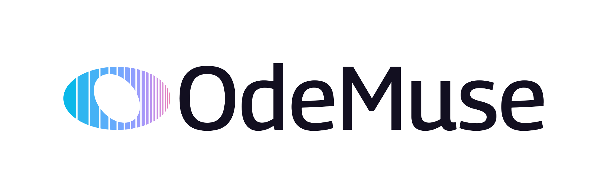

<a href="https://odemuse.com">
  <picture>
    <source media="(prefers-color-scheme: dark)" srcset="docs/images/odemuse-logo-light-text.svg">
    
  </picture>
</a>

# Ode

**Ode** is an AI musician that lives in your digital audio workstation (DAW), the software you use to record, arrange and produce music. It currently supports [Ableton Live](https://www.ableton.com/en/live/) and helps you throughout the music creation process. You can brainstorm a song concept together, draft and revise lyrics, and work out and practise a melody. As the song takes shape, you can move into production: build the instrumental parts, choose sounds, arrange the sections and refine the mix, listening and making changes together in the same project.

**Ode** is the first product of [OdeMuse](https://odemuse.com), whose mission is to use AI to boost the creativity and capabilities of musicians.

A project in Live is called a **Set**. It contains **tracks**, such as drums, bass, and vocals. Tracks hold **clips** containing audio recordings or MIDI notes, and **devices** that generate or process sound. MIDI describes a performance through note pitches, timing, duration, and velocity; an instrument turns those instructions into audio. These are the objects Ode reads and changes.

For example, a musician can right-click a bass clip and ask, “Make this less busy while the singer is singing, but keep the lead-in to the chorus.” Ode receives the clip as context, reads its notes and the surrounding project, and can replace the relevant notes in place. With the Meta provider, it can also capture the passage from Live and receive that recording in the same agent conversation. The musician can hear and inspect the resulting bass part, then give another instruction.

Ode also has a lyric editor, remembered artist and song context, reference attachments, and a history of the project state it can observe. Its musical decisions come from the configured models. Local code connects those decisions to Live, validates tool inputs and returned data, and manages persistence and recovery.

## How Ode fits into Live

Ode ships as two files that work together. The `.ablx` file is an **extension**, installed through Live's settings. It hosts the application, runs the agent, and uses Ableton's **Extensions SDK** to inspect and edit Live objects. SDK means software development kit: the API and tools Ableton supplies for writing these integrations in JavaScript or TypeScript.

The second file, `Ode.amxd`, is a **Max for Live device**. Max for Live integrates Max, a visual programming environment, into Live. In Max, developers connect components that handle sound, data, and interface controls to build a program called a patch; Max for Live lets that patch run as a device on a track. [How Max works](https://cycling74.com/products/max), [Max for Live](https://www.ableton.com/en/live/max-for-live/).

Ode uses its Max device to display a floating window, capture processed audio, and access native controls that complement the extension API. Max for Live is included with Live Suite. [Suite's bundled Max installation](https://help.ableton.com/hc/en-us/articles/360000036850-Max-for-Live-bundled-in-Live).

The two components address different needs in Ode's current design. The extension provides the Node.js application host and structured access to Live's project objects. The pinned SDK exposes modal webviews and pre-effects rendering of Arrangement audio tracks; those facilities do not provide Ode's persistent companion window or a recording of processed MIDI instruments and the full mix. The Max device supplies that window and native signal capture, along with control operations missing from the SDK path. [Live integration](docs/live-integration.md) explains the division and its limits.

The Extensions SDK is newer and currently requires **Live 12 Suite Beta, version 12.4.5 or later**. That requirement comes from Ableton's extension platform; a regular Live installation without Extensions is insufficient. Ode targets SDK `1.0.0-beta.1`. [Ableton's Extensions requirements](https://www.ableton.com/en/live/extensions).

Start with the [architecture guide](docs/architecture.md) for the component map. The [workflow guide](docs/workflow.md) follows startup and a complete request, while [Tools and permissions](docs/tools.md) explains how the agent's operations are grouped, validated, and executed.

## Install and try Ode

You need a compatible Live 12 Suite Beta on macOS or Windows, Extensions enabled, and an API key for the provider you select in Ode. For the workflow that includes listening, choose Meta. Use **Max 9.2 or later on macOS**, or Max 9.1 or later on Windows. Max 9.2 fixes the Command-key handling in embedded web views inside Max for Live devices; an older bundled Max can display Ode while leaving Copy, Paste, Cut and Select All unavailable. [Cycling '74's fix](https://cycling74.com/releases/max/9.2.0).

If Live on macOS includes an older Max, install the current version from [Cycling '74](https://cycling74.com/downloads), select its application under **Live Settings → File & Folder → Max Application → Browse**, and restart Live. The [getting-started guide](docs/getting-started.md#select-the-max-runtime-on-macos) explains this setup. It keeps Ode in its embedded window.

1. Open the [releases page](https://github.com/odemusehq/Ode/releases) and download `Ode.amxd` and the `.ablx` for your computer: `darwin-arm64` for an Apple silicon Mac, `darwin-x64` for an Intel Mac, or `win32-x64` for Windows.
2. In Live, open **Settings → Extensions** and drop the `.ablx` onto that page, or use **Choose file**. Confirm the installation, then restart Live when prompted. Developer Mode can stay off when installing a release.
3. Drag `Ode.amxd` onto an audio track or the **Main** track, which receives the combined mix. Keep one Ode device in the Set.
4. Click **Open Ode** on the device. In Ode's **Settings**, choose a provider and model, enter your API key, and save.
5. Right-click an existing clip, track, or time selection and choose **Ask Ode**. Describe a specific change to try, then inspect and play the result in Live.

The extension is installed once; the device belongs in each Set where you use Ode. Saving it in a Live template makes it available when starting another project. The [getting-started guide](docs/getting-started.md) explains the controls and model settings. The [screenshot walkthrough](docs/tutorial.md) follows installation, the macOS Max setup, a blank Set, a real bass-line request, and the result in Live's MIDI editor.

## What the current implementation covers

The agent can inspect the Set, edit MIDI and clips, work with native instruments and effects, and use the additional controls exposed through Ode's Max device. Its skills supply songwriting and production guidance for tasks such as arranging a chorus, developing a melody, or revising lyrics. A skill is text the agent reads when relevant; the available APIs determine which actions it can perform. The bundled default model is Meta's Muse Spark 1.3 (`muse-spark-1.3`), with provider and model choices defined in the [catalogue](src/services/providers.json).

Listening uses captured audio as model input. The Meta transport supports this in the main conversation; the current Baseten and Modal transports do not carry audio into the agent. Ode's audio code prepares files and preserves source information, while the model assesses what it hears. It does not provide a local loudness analyser or certify a mix as ready for delivery.

The lyric editor uses a separately configured model for writing and for syllable, pronunciation, stress, and rhyme interpretation. It can associate syllables with actual MIDI notes, keeping the text, annotations, and melody connected. [Lyrics](docs/lyrics.md) explains how those associations survive edits and when they need review. The interface also accepts attached references and microphone input; spoken dictation becomes editable message text before the musician sends it.

Some operations still require the musician to act in Live, including general Browser preset loading, recording a vocal, drawing unsupported automation, saving the Set, and exporting the finished song. Ode's History preserves supported observed state and can refuse a restoration it cannot perform safely. It does not replace saving the Live Set. [Memory and history](docs/memory-and-history.md) describes what is stored and what recovery can reconstruct.

## Technical documentation

These guides assume programming knowledge and introduce the Ableton concepts they use.

| Guide | What it explains |
| --- | --- |
| [Getting started](docs/getting-started.md) | Installation, provider setup, and working with Ode in a Set. |
| [Screenshot walkthrough](docs/tutorial.md) | Installation screens, Max runtime setup, a blank Set, a real MIDI result, and Ode's panels. |
| [Architecture](docs/architecture.md) | The application components and the path from a musician's request to a native edit. |
| [Workflow](docs/workflow.md) | Startup, message acceptance, context preparation, model and tool calls, listening, and completion. |
| [Tools and permissions](docs/tools.md) | The five tool groups, mutation metadata, agent access, native dispatch, and recovery evidence. |
| [Live integration](docs/live-integration.md) | Extensions SDK operations, Max for Live controls, audio capture, and host limits. |
| [Lyrics](docs/lyrics.md) | Model interpretation, revision handling, and lyric-to-MIDI associations. |
| [Memory and history](docs/memory-and-history.md) | Artist context, song storage, conversations, and recovery. |
| [Development](docs/development.md) | Local setup, source layout, validation, packaging, and releases. |

To build from source, start with [Development](docs/development.md). The project requires Node.js `24.16.0` or later and the two Ableton SDK package archives named in [package.json](package.json).

## License and names

Ode is licensed under the [PolyForm Strict License 1.0.0](LICENSE).

OdeMuse and Ode are independent and are not affiliated with, endorsed by, or sponsored by Meta Platforms, Inc. or Ableton AG. “Muse” in OdeMuse refers to the Muses of Greek mythology; the brand was chosen before Meta released its Muse models. Ode can use Meta's models alongside other supported providers.

Meta is a trademark of Meta Platforms, Inc., and the Muse models are its products. Ableton and Ableton Live are trademarks of Ableton AG.
