<a href="https://odemuse.com">
  <picture>
    <source media="(prefers-color-scheme: dark)" srcset="docs/images/odemuse-logo-light-text.svg">
    
  </picture>
</a>

# Ode

**Ode** is an AI musician that lives in your digital audio workstation (DAW), the software you use to record, arrange and produce music. It currently supports [Ableton Live](https://www.ableton.com/en/live/) and helps you throughout the music creation process. You can brainstorm a song concept together, draft and revise lyrics, and work out and practise a melody. As the song takes shape, you can move into production: build the instrumental parts, choose sounds, arrange the sections and refine the mix, listening and making changes together in the same project.

**Ode** is the first product of [OdeMuse](https://odemuse.com), whose mission is to use AI to boost the creativity and capabilities of musicians.

A project in Live is called a **Set**. It contains **tracks**, such as drums, bass, and vocals. Tracks hold **clips** containing audio recordings or MIDI notes, and **devices** that generate or process sound. MIDI describes a performance through note pitches, timing, duration, and velocity; an instrument turns those instructions into audio. These are the objects Ode reads and changes.

For example, a musician can right-click a bass clip and ask, “Make this less busy while the singer is singing, but keep the lead-in to the chorus.” Ode receives the clip as context, reads its notes and the surrounding project, and can replace the relevant notes in place. With the Meta provider, it can also capture the passage from Live and receive that recording in the same agent conversation. The musician can hear and inspect the resulting bass part, then give another instruction.

Ode also has a lyric editor, remembered artist and song context, reference attachments, and a history of the project state it can observe. Its musical decisions come from the configured models. Local code connects those decisions to Live, validates tool inputs and returned data, and manages persistence and recovery.

## How Ode fits into Live

Ode ships as two files that work together. The `.ablx` file is an **extension**, installed through Live's settings. It hosts the application, runs the agent, and uses Ableton's **Extensions SDK** to inspect and edit Live objects. SDK means software development kit: the API and tools Ableton supplies for writing these integrations in JavaScript or TypeScript.

The second file, `Ode.amxd`, is a **Max for Live device**. Max for Live integrates Max, a visual programming environment, into Live. In Max, developers connect components that handle sound, data, and interface controls to build a program called a patch; Max for Live lets that patch run as a device on a track. [How Max works](https://cycling74.com/products/max), [Max for Live](https://www.ableton.com/en/live/max-for-live/).

Ode uses its Max device to display a floating window, capture processed audio, and access native controls that complement the extension API. Max for Live is included with Live Suite. [Suite's bundled Max installation](https://help.ableton.com/hc/en-us/articles/360000036850-Max-for-Live-bundled-in-Live).

The two components address different needs in Ode's current design. The extension provides the Node.js application host and structured access to Live's project objects. The pinned SDK exposes modal webviews and pre-effects rendering of Arrangement audio tracks; those facilities do not provide Ode's persistent companion window or a recording of processed MIDI instruments and the full mix. The Max device supplies that window and native signal capture, along with control operations missing from the SDK path. [Live integration](docs/live-integration.md) explains the division and its limits.

The Extensions SDK is newer and currently requires **Live 12 Suite Beta, version 12.4.5 or later**. That requirement comes from Ableton's extension platform; a regular Live installation without Extensions is insufficient. Ode targets SDK `1.0.0-beta.1`. [Ableton's Extensions requirements](https://www.ableton.com/en/live/extensions).

Start with the [architecture guide](docs/architecture.md) for the component map. The [workflow guide](docs/workflow.md) follows startup and a complete request, while [Tools and permissions](docs/tools.md) explains how the agent's operations are grouped, validated, and executed.

## Getting started

Ode runs alongside the music in an Ableton Live project. You install its extension once, then load its Max for Live device in the project you want to work on. The device opens Ode's interface and connects it to that instance of Live.

If you are new to Live, a **Set** is its project document. A **track** holds a musical part, such as a bass instrument or a recorded vocal. A **clip** holds a passage of MIDI notes or an audio recording. MIDI stores performance instructions, such as note pitch, timing, and duration, which an instrument turns into sound. A **device** is an instrument, effect, or other tool placed on a track. Ode's own device is one of these tools; it provides the window and native connection while the extension runs the application.

### Requirements

- Ableton Live 12 Suite Beta, version 12.4.5 or later, with Extensions enabled. Choose the Live Beta download on the [official Extensions page](https://ableton.github.io/extensions-sdk/); the SDK download there is for developers.
- Max for Live with Max 9.2 or later. Max for Live is included with Suite.
- An API key for the provider you choose. Model requests need Internet access; Ode stores credentials in its local settings and sends request content to that provider.

Ode targets Extensions SDK `1.0.0-beta.1`; future SDK versions may expose different capabilities.

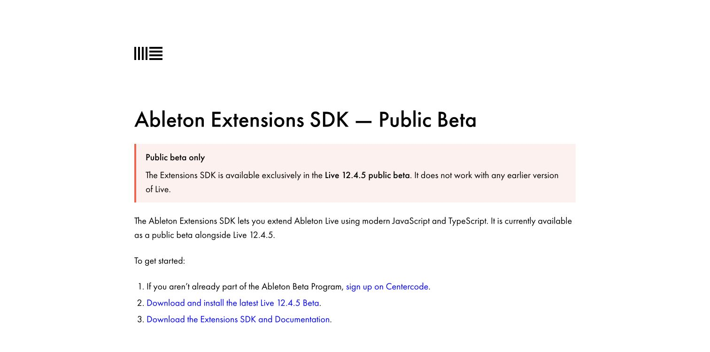

Max for Live lets Live load custom `.amxd` devices. Ode uses its device for the floating interface and native audio and control functions.

### Select the Max runtime on macOS

Live includes a version of Max, but that bundled version can lag behind Cycling '74's current release. This matters for Ode because Max 9.2.0 fixes Command-key handling in web views inside Max for Live devices. With an older runtime, ordinary typing can work while Copy, Paste, Cut and Select All fail. This is a host issue affecting standard text fields. [Max 9.2.0 release notes](https://cycling74.com/releases/max/9.2.0).

If Live's bundled Max is older than 9.2, download the current macOS version from [Cycling '74](https://cycling74.com/downloads) and install `Max.app` in Applications. In **Live Settings → File & Folder**, find **Max Application**, click **Browse**, and select the installed `Max.app`. Save your work and restart Live so the setting takes effect. Ableton documents this application-path setting in [Setting Up Max for Live](https://www.ableton.com/en/live-manual/12/max-for-live/#setting-up-max-for-live).

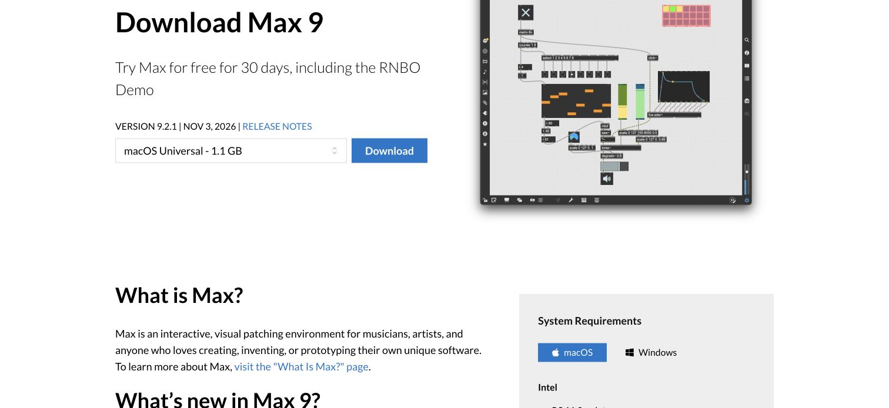

Open the downloaded disk image and install Max in Applications.

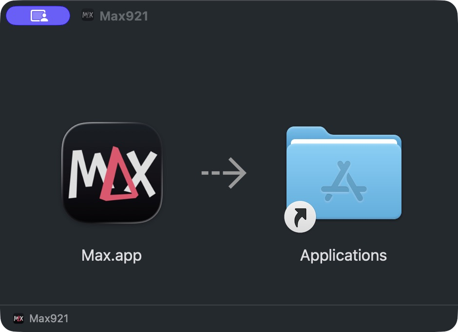

The Max Application setting should point to the installed application:

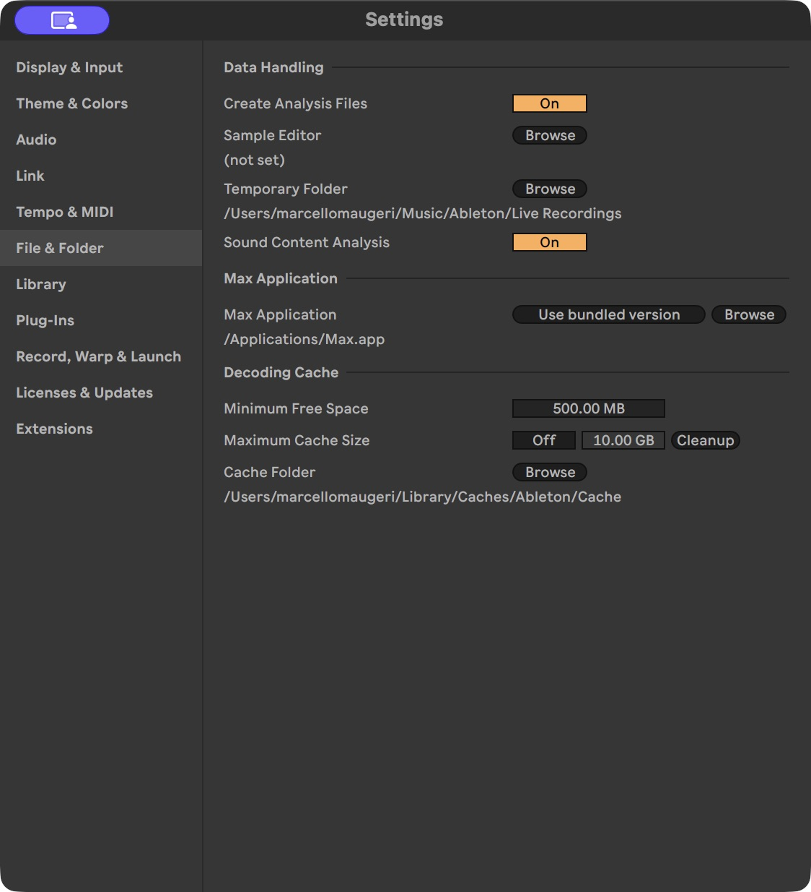

This selects the runtime that hosts Ode's window and device. There is no Ode setup step in the Max Console or patch editor. After opening Ode, check that text entry and the usual editing shortcuts work before configuring credentials or starting a session.

### Install the two release files

Open the [Ode releases page](https://github.com/odemusehq/Ode/releases). Download `Ode.amxd` and the extension package for your operating system and processor. Release packages use these suffixes:

| Your computer | Extension suffix |
| --- | --- |
| Apple silicon Mac | `darwin-arm64.ablx` |
| Intel Mac | `darwin-x64.ablx` |
| Windows PC | `win32-x64.ablx` |

In Live, open **Settings → Extensions** and drop the downloaded `.ablx` onto the page, or select it with **Choose file**. Installing a packaged release does not require Developer Mode, so leave it off. If an older Ode extension is installed, uninstall that entry first; Live currently refuses to install over its existing extension folder.

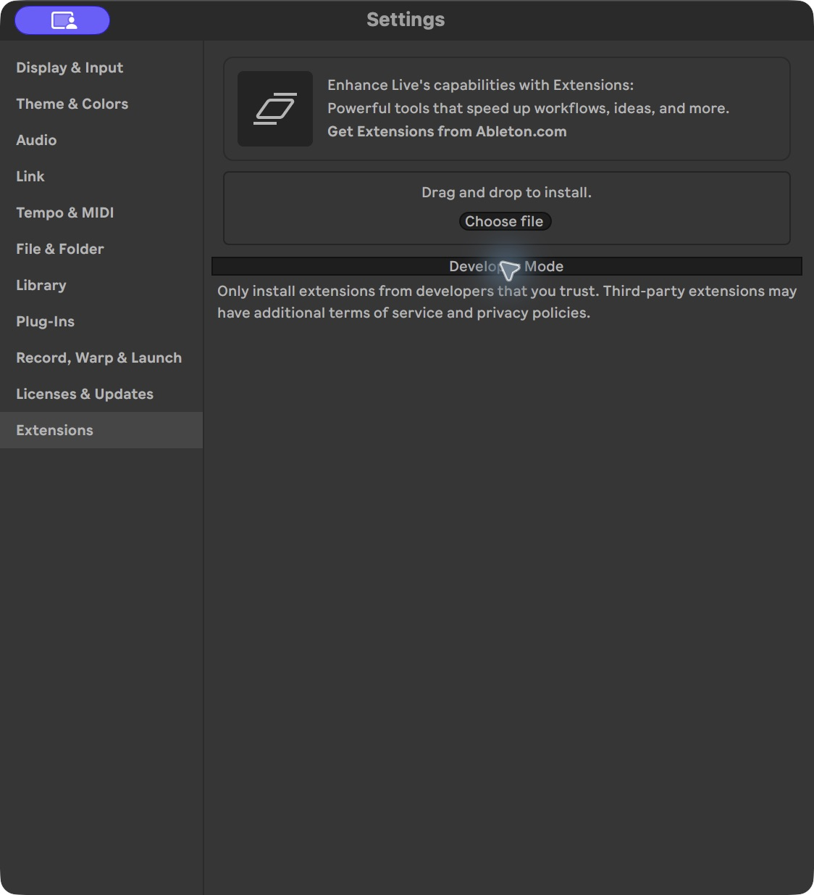

Live identifies **Ode** by **OdeMuse** before installing it. Check those names, then confirm.

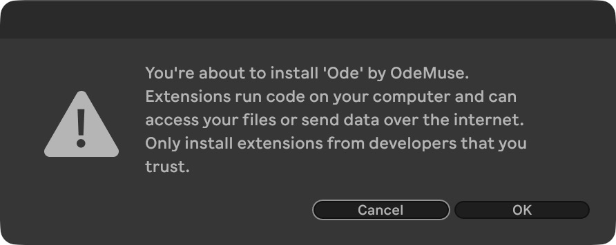

When installation finishes, save any open work and restart Live as requested.

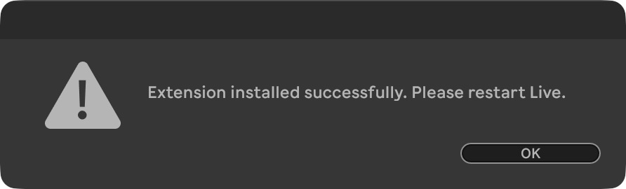

After restarting, Ode should appear in Installed Extensions. This capture shows version 0.3.1, with Developer Mode still off.

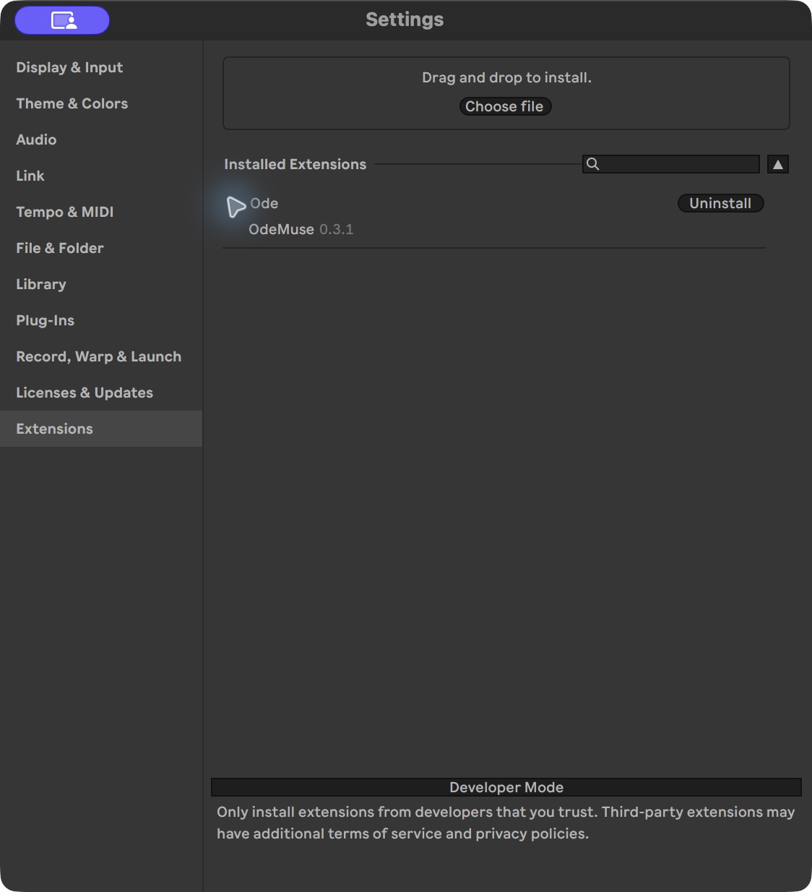

Drag `Ode.amxd` onto an audio track or the Main track in your Set. Main receives the combined mix. Once Ode is open and configured, [make your first song](#make-your-first-song-with-ode) walks through a creative session.

Keep **one Ode device per Set**. The extension finds the device through its native controls and pairs with it automatically. Two copies make that pairing ambiguous. If the device is missing or cannot respond, opening Ode from a right-click menu produces an instruction explaining what needs attention.

Click **Open Ode** on the device. Ode appears in a floating window hosted by Max for Live, so you can keep it beside Live while working. You can also use **Open Ode** on a track or scene's right-click menu. The extension supplies separate **Lyrics**, **History**, and **Settings** actions for those views.

### Configure the models

Open **Settings** in Ode and select the main provider and model. The bundled catalogue supports Meta, Baseten, and Modal. Meta and Baseten offer the model choices listed in the catalogue; Modal can request a model list using your key. The exact identifiers live in [providers.json](src/services/providers.json), which is the source of Ode's choices.

Choose **Meta** to use the complete listening path described in these guides. In that configuration, a recording captured from Live becomes audio input in the main agent conversation. The current Baseten and Modal agent transports support text interaction and tools, but do not attach audio to the agent. A model's own advertised capabilities do not establish support in a particular transport.

Lyrics support has its own provider and model setting. It currently offers Meta models and can reuse the saved Meta key. If you choose a different provider for the main agent, supply a Meta key for lyrics and speech transcription as needed. The [model-role resolver](src/services/model-roles.ts) determines which credential each role uses.

An installed release reads its persistent Settings, not the repository's `.env` file. That file is for source development; [Development](docs/development.md) explains the optional credential import for developers.

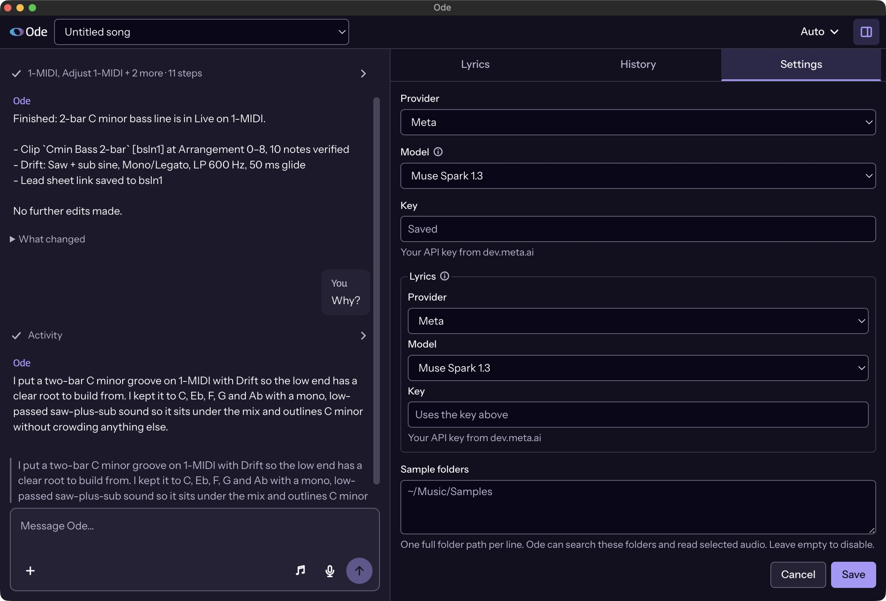

### Make a first change

Start with an existing part you can recognise, such as a short bass or drum clip. Right-click it and choose **Ask Ode**. This gives Ode an explicit target along with your message. A request such as “Simplify this bass while the singer is singing, keeping the lead-in to the chorus” gives it both an intended change and material to preserve.

Ode reads the project and the details it needs, then performs supported edits through Live's native APIs. Its activity shows public action descriptions and tool progress. After it finishes, inspect the notes or device settings in Live and play the passage. With Meta selected, Ode can capture processed audio and listen during its work as well.

The target from a right-click is context, rather than a permanent selection lock. If you move on to a different part, point Ode at that part or describe it explicitly. The agent is instructed to read current material before changing it because the musician can edit the same Set between requests.

### References and microphone input

You can attach files or a selected folder as references for the conversation. Ode retains those selections so the agent can reopen relevant material later. An attachment can describe a musical direction or provide something to listen to; its filename alone does not establish that the model inspected its contents.

Where the embedded browser supports microphone recording and permission is granted, the input offers two recording actions. Dictation sends speech to the configured Meta transcription service and appends the recognised words to your message draft. You can edit them before pressing Send. Audio recording instead attaches a recording as a reference, so the main agent can receive the sound when you send the request. Sending an audio reference to the agent needs the Meta listening configuration described above; a transcription key by itself does not add audio support to a different main transport.

### Control and continuation

**Auto** mode lets Ode perform clear requested changes. **Manual** mode waits for Apply or Skip before musical and settings changes. Some actions, such as deletions outside supported recovery, require approval in either mode. Background artist-memory updates and production checkpoint updates have separate rules, described in [Architecture](docs/architecture.md).

Use **Stop** to interrupt a running agent request. Operations already issued to Live may still settle, and completed edits can remain in the Set. Ode records the state it can observe after interruption so later work can reconcile with it. Stop is therefore useful for changing direction, but does not promise to roll back every action.

The Lyrics view holds the song's text and annotations. History shows the state changes Ode has recorded, including recovery limits. Ode's song selector changes its stored song context; it does not open a different `.als` project in Live. Keep the selected Ode song matched to the Set you are actually editing, and save the Set in Live as you normally would.

For the implementation behind this session, continue with [Architecture](docs/architecture.md). For a supported action that still needs a manual Live step, see [Live integration](docs/live-integration.md).

## Make your first song with Ode

We are going to make **Night Walk**, a short electronic song about walking home with someone and not wanting the night to end. We will start with a sentence in Ode, develop it into lyrics, and sing them against a melody guide in Live. Then we will work with Ode to fix crowded wording, awkward accents and uncomfortable notes before building the accompaniment, arranging and exporting the song.

If you have not installed Ode yet, follow [Getting started](#getting-started), then come back here with Live and Ode open. That guide covers Live Beta, Max, the extension and your model settings.

### Create a new project

Choose **File → New Live Set**, then save it as **Night Walk**. A Set is Live's name for a project.

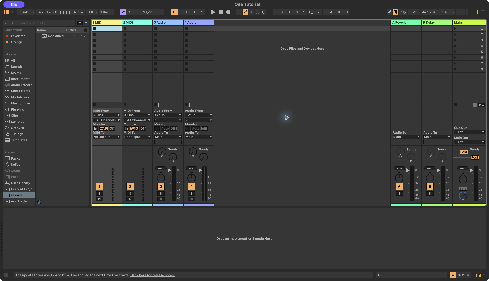

*A new Set in Session View. The empty slots will hold musical clips as you build the song.*

Load one `Ode.amxd` device on **Main**, the track that receives the combined sound from the other tracks, and click **Open Ode**. In Ode's song menu, choose **New song…** and call that **Night Walk** too. Live's Set and Ode's song context are separate: the matching names help you keep the music and its conversation together.

Keep Live on the left of your screen, with roughly sixty per cent of the space, and Ode on the right. You want enough room to see the notes and tracks while keeping the conversation readable. Close Live's Browser when you are not choosing a sound; that gives the music more room.

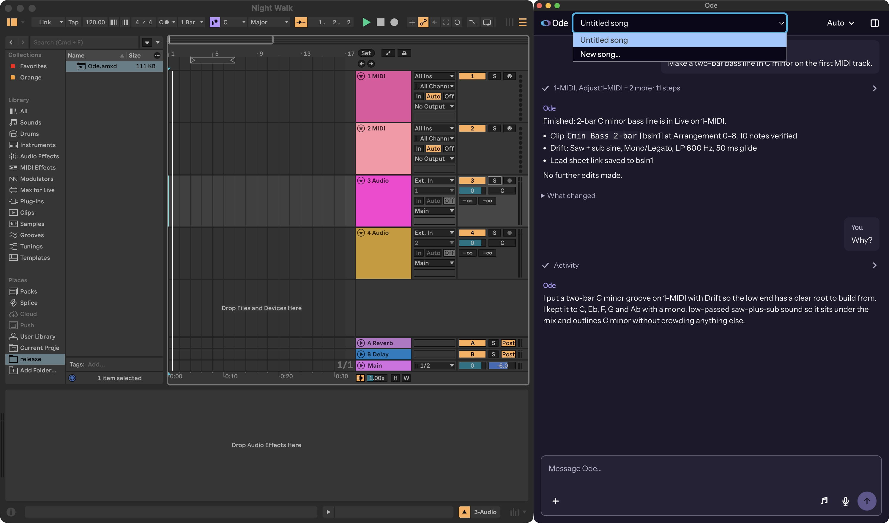

*Live and Ode in a 60/40 split, with **New song…** open.*

Use Live's **Arrangement View** for the rest of the walkthrough. If you still see the vertical clip slots from the first screenshot, click in Live and press **Tab** to switch views. The Arrangement timeline runs from left to right, so you will be able to watch a short idea grow into a song. Each horizontal track holds a part, such as bass, drums or melody. The numbered divisions across the top are bars, the repeating groups of beats that help musicians keep their place.

### Start the song in Ode

Open Ode's side panel with the button at the top right, then choose **Lyrics**. Keep the conversation visible beside it. You will use the chat to develop the song with Ode and the Lyrics panel to read and edit the resulting text.

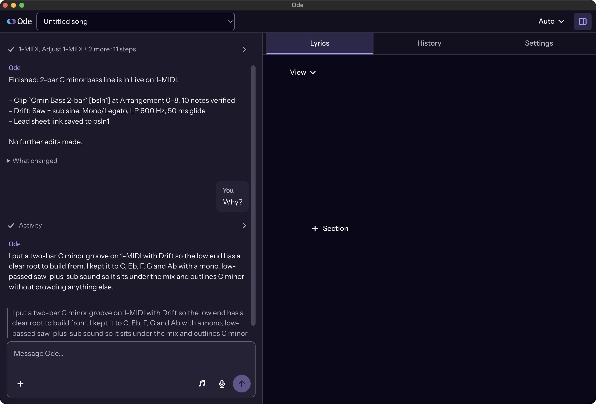

Click Ode's message box and send this sentence:

> I want to write a song about taking the long way home with someone because I don't want to say goodbye yet.

This gives Ode the situation and the feeling behind it. Read its reply, then add a detail that the lyrics can build on:

> We could have caught the last bus, but neither of us suggested it. Can you turn that into a first verse? Put it in Lyrics so we can work on it.

Now look in **Lyrics**. The first verse belongs in the document, where you can read its lines together while continuing the conversation. Read it aloud. Listen for whether it sounds like someone speaking to the person beside them, and whether the scene expresses the hesitation you started with.

### Develop the lyrics with Ode

Choose a detail from the verse that you want to develop. To keep the missed bus as a shared choice, send:

> I like the bit about the bus. Make it feel like we both let it go, rather than one of us being left behind.

Read the updated verse in Lyrics. The event can stay the same while the wording changes who wants to remain there. This is a lyric revision about meaning: you are giving Ode feedback on the story before deciding how to sing it.

Next, take a shorter phrase from your original sentence and suggest it as the chorus:

> Could “Take the long way home” be the chorus? I want that to be the part people remember.

The **chorus** is the returning section that carries the central idea; its recognisable phrase is the **hook**. Once Ode proposes a chorus, ask it to put the version you want to try in the document:

> Let's try that. Add it as the chorus in Lyrics, and keep the verse.

Read the two sections together in Lyrics. The verse should establish the walk and the missed opportunity to go home, while the chorus turns the feeling into something the narrator can say to the other person. To make the last line recall the bus, continue:

> Can the chorus end with “We just let the last bus go”? I like having that little moment come back.

Example chorus draft:

```text
[Chorus]
Take the long way home
Past the places that we know
We could keep on walking for another mile
We just let the last bus go
```

Read the chorus in Lyrics, then ask Ode for a melody so you can try singing the words.

### Create a vocal melody in Live

In the same conversation, ask:

> Can we find a tune for the chorus? Something warm and easy to remember. Put a simple guide on Live's timeline so I can sing along.

Ode can create a **MIDI clip**, which holds the pitches, starting times and lengths of the notes. An instrument on its track turns those notes into sound. The guide plays the melody for you to sing against; recording your own vocal comes later.

Select the guide clip in Live. Press **Shift+Tab** if the lower panel shows the instrument instead of the MIDI note editor. The rectangles are notes: their vertical position shows pitch, their horizontal position shows when they start, and their width shows duration. Click in Live and press **Space** to play or stop.

Back in Ode, send:

> Can you show which notes go with each syllable in Lyrics?

Ode associates the words with the actual MIDI notes in Live. In **Lyrics**, click inside a word and then click the **music-note button**, labelled **Edit melody**. Once its syllables are linked, their pitch and note-value controls become available. This lets you inspect the notes for the exact word you are working on while keeping the guide visible in Live.

Play the guide and sing the chorus aloud. Pay attention to where you run out of time, which words receive the strongest accents and whether the notes sit comfortably in your voice. Use what you hear to make the next request.

### Fit the words to the melody

For the example chorus, sing the third line, “We could keep on walking for another mile”. If you have to rush through it, return to Ode's chat and say:

> I'm running out of room on “We could keep on walking for another mile”. Can you shorten that line? I want to keep “another mile”, and I like the opening melody.

Ode can read the guide's actual notes and use their timing when proposing a shorter lyric. Review the proposed wording before applying it. One revision to try is “We can walk another mile”:

> Let's use “We can walk another mile”. Fit that into the third line, but leave “Take the long way home” as it is.

Look at the third line in Lyrics and play the guide again. You are checking both the changed text and how Ode fits it into the phrase. The chorus opening is the part you asked it to preserve.

To inspect the wording, open **View** in Lyrics and enable **Syllables** and **Syllable counts**. A **syllable** is a unit of pronunciation, usually centred on a vowel sound. After the text is checked, light dividers show its syllable boundaries and a count appears at the end of each line. The example revision removes four syllables:

| Wording | Syllables | Count |
| --- | --- | --- |
| We could keep on walking for another mile | We / could / keep / on / walk / ing / for / a / noth / er / mile | 11 |
| We can walk another mile | We / can / walk / a / noth / er / mile | 7 |

Sing the shorter wording against the revised guide. There should be enough space to say “another” clearly and finish “mile” without swallowing it. The syllable count helps explain the crowded line; singing it tells you whether the new phrasing works.

### Fix the melody while keeping the words

### Correct an awkward accent

Now keep the shorter text and listen to how the melody pronounces “another”. Its natural **word stress** is on the middle syllable, a-**NOTH**-er. A tune that gives too much weight to the last syllable can make the word sound unnatural. Tell Ode what you hear:

> The words fit now, but “another” sounds odd when I sing it. The tune leans on the last syllable. Can you put the weight on the middle one? Keep the words.

Here Ode needs to revise the musical phrase. Giving the middle syllable a more prominent note or changing its rhythmic placement can support the way the word is spoken. Play the updated MIDI guide and sing the line again, listening specifically to a-**NOTH**-er.

In Lyrics, click “another” and open **Stress** to inspect the pronunciation. The middle syllable should carry **Primary stress**. To inspect the musical change, open **Edit melody** for the same word and compare its linked pitches and note values with the notes in Live. Changing a stress mark alone does not change how the guide sounds; the correction must also reach the MIDI melody.

The fit between language, music and intended meaning is part of **prosody**. [Berklee's explanation of prosody](https://online.berklee.edu/takenote/prosody-in-music-and-songwriting/) describes how those elements work together in a song.

### Make a phrase comfortable to sing

If the end of the third line feels too high, send:

> The note on “mile” is too high for me. Can the end of that line come down a little? Keep the opening; I like that part.

Check “mile” in Lyrics and listen to the changed phrase in Live. This time the wording stays the same and Ode changes the **pitch**, how high or low the note sounds. Sing the whole chorus to hear how the revised ending connects to the next line.

If the whole chorus sits too high, ask instead:

> Can we move the whole chorus lower? I like the tune, but it's sitting too high for my voice.

Moving all its pitches by the same amount is **transposition**. It preserves the distances between the notes while moving the melody higher or lower. Sing it again to check that both its lowest and highest notes feel comfortable. When adding the accompaniment below, ask Ode to use the key you settled on for the vocal.

### Leave room to breathe

If “home” runs straight into the next line, ask:

> I need a breath after “home”. Can you leave a little space there without breaking up the chorus?

Ode can shorten the held note or move the next entrance to create a **rest**, a period when the melody is silent. Listen to the gap and sing through the transition. This is a change to **phrasing**: how the notes and words form a musical sentence, including its breathing spaces.

You can also make a small edit yourself. In Lyrics, select a linked word and open **Edit melody**. The first selector changes a note's pitch; the second changes its duration. In 4/4, a quarter note lasts one beat and a half note lasts two. Changing the duration leaves the next note's starting time in place, so ask Ode to adjust the surrounding phrase when the breath needs more room.

In [Live's MIDI editor](https://www.ableton.com/en/live-manual/12/editing-midi/), moving a note vertically changes its pitch, moving it horizontally changes its starting time, and dragging its right edge changes its duration. If an edit leaves **Review melody alignment** in Lyrics, ask Ode to read the current clip and reconnect the syllables to its notes.

### Write the verse melody

Once the chorus is comfortable, return to the chat:

> Give the verse a quieter, more conversational melody. Keep it lower than the chorus so “Take the long way home” feels like a lift when it arrives.

Play from the verse into the chorus, singing from the Lyrics panel. Check that the verse leads naturally into the chorus and that you have time to breathe between them. Ask Ode to revise any transition that makes you rush, then keep the vocal guide in the Set while you build the accompaniment.

### Create a bass line

In Ode, write:

> Let's build the backing around this vocal. I want a warm, late-night electronic feel. Can we start with a bass groove?

When Ode finishes, select the new bass clip in Live to inspect its notes. Keep the vocal guide playing while you listen to whether the bass supports the melody and leaves room for its phrases.

Click in Live and press **Space** to play; press it again to stop. Listen for a pulse you could build a beat around. A bass line can be interesting without filling every gap; the spaces between its notes will matter when the other parts arrive.

If the bass feels too busy, try “Make it softer and less restless.” If there is a phrase you like, tell Ode to keep it while changing the rest.

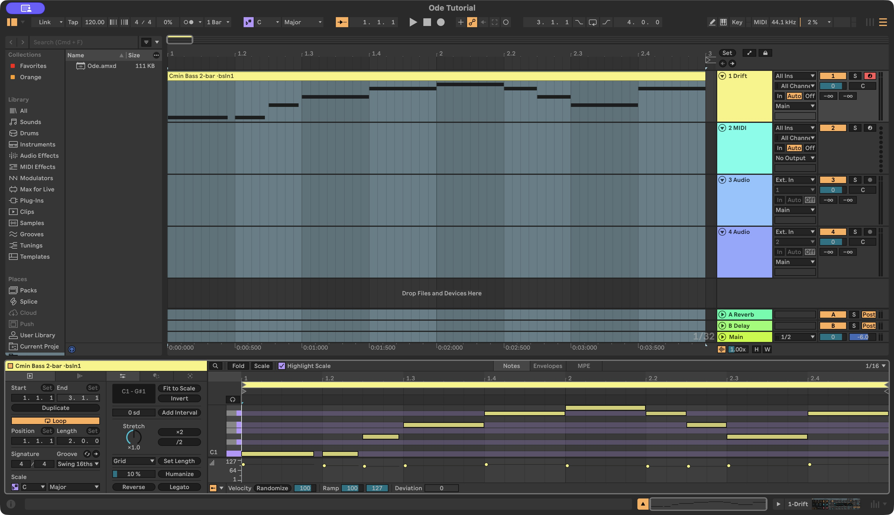

*A bass clip on the first track, with its individual notes open in Live's MIDI editor.*

To make a revision about a particular part, right-click its clip in Live and choose **Extensions → Ode: Ask Ode**. This gives Ode the clip as context along with your message. You can then describe what you want to change in ordinary musical terms.

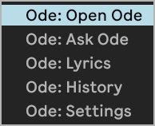

### Add drums

Once you want to keep the bass groove, give it something to move against:

> Add a relaxed drum groove around this. I want it to move, but still feel unhurried.

Ode can write the drum notes, but those notes need drum sounds. If it asks you to load a kit in Live's Browser, load the kit it names before continuing.

Play the bass and drums together. The kick is the low drum that gives the beat its weight. The snare or clap often marks the second and fourth beats of a bar, giving the groove its backbeat. Listen to whether the bass and kick feel connected.

If the kick obscures the bass, ask Ode to give them more space. If the rhythm works but the drums feel too heavy, ask for a lighter sound while keeping the pattern.

Save the Set before adding the next part.

### Add chords

The bass gives the song a foundation, but you may still want a sense of mood and movement above it. Ask:

> Add some soft chords. Keep them out of the bass's way and leave plenty of space.

A chord is a group of notes played together. A sequence of chords can make the same bass groove feel settled, tense, hopeful or unresolved. Listen to a complete pass of the sequence before deciding whether it fits the late-night idea.

Look at the new track in Live as you listen. You can select its clip to see how its notes line up with the bass and drums. Watch where the chords change, and listen to how that changes the feeling of the groove.

If the chords make the track feel too sweet, too dramatic or too crowded, tell Ode that. Keep the part of the original idea you still want. A message such as “Keep the warmth, but make the chords a little more melancholy” gives it a direction to revise towards.

### Arrange the song

A loop repeats the same passage. An arrangement decides when each part enters, how the energy changes and where the music comes to rest. Once the parts work together, ask:

> Arrange this into a short song. Start quietly, build from the verse into a fuller chorus, then bring the chorus back once more before the ending.

The **verse** develops the story, while the **chorus** returns to the hook. The opening can introduce the accompaniment before the first verse.

Watch the Arrangement timeline as Ode works. Instead of a single group of clips, you should be looking for passages that do different jobs. Play from the beginning rather than judging only the fullest section. The important change is what it feels like to arrive there after the opening.

If the chorus feels too similar to the section before it, explain the effect you want:

> I want the chorus to feel like it opens up, without just getting louder.

Ode can revise which parts enter, their rhythms or their sounds. Afterwards, play the transition again to hear whether the chorus has the lift you wanted.

To give the returning chorus a small variation, ask:

> On the last chorus, let “home” move through two notes before it settles. Keep the earlier chorus simple.

Singing one syllable across several pitches is a **melisma**. Holding “home” on a single pitch for longer is a sustained note; moving through two pitches on the same syllable makes it melismatic. The distinction between syllabic and melismatic settings is also covered in the [College Board music theory guide](https://apstudents.collegeboard.org/sites/default/files/2019-05/ap-music-theory-course-and-exam-description.pdf).

### Listen and revise

Stop editing for a moment and play the song through. Pay attention to the point where your interest drops, a part gets in the way or the ending arrives too suddenly. Pick the thing that most affects the song and talk about that first.

For example, if the drums obscure the vocal guide, say “The melody disappears when the drums come in.” If the final note ends too abruptly, try “The ending feels cut off; let it settle.”

With Meta configured, Ode can also listen to a recording from Live. You might ask:

> Listen to it as a whole. Do the parts feel balanced, or is anything getting in the way?

Give it time to capture and assess the actual sound, then listen to any changes yourself. The conversation helps you decide what to try; the music playing from Live is what you are making decisions about.

You can press **Stop** while Ode is working if you need to interrupt it. Changes already made may remain, so look at the Set before deciding what to do next. **History** can help you inspect retained changes and recover supported state, but keep saving the project in Live as well.

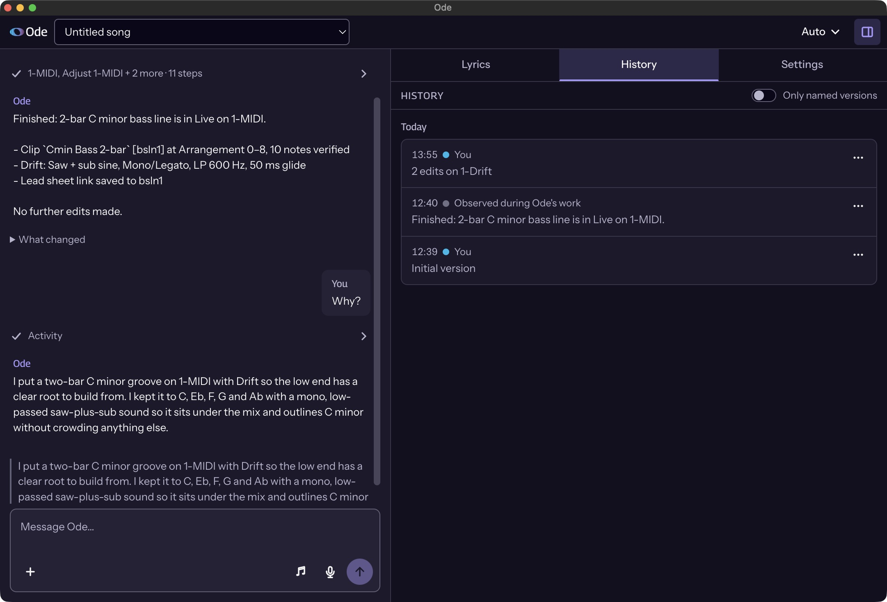

*History with the initial version and changes to the bass.*

### Save and export

When the song reaches a point you want to keep, save the Set. If you are about to try a larger change, use **Save Live Set As…** to keep a separate version first. That gives you a clear way back to the arrangement you liked.

To make an audio file you can play outside Live, select the whole song on the Arrangement timeline, allowing room for sounds that continue after the last note. Open **File → Export Audio/Video**. Choose **Main** under **Rendered Track** to export the combined mix, and **WAV** under **File Type** for a lossless audio file. Check the start, length and destination, then export. Ode leaves this final step to you. [Ableton's export guide](https://www.ableton.com/en/manual/managing-files-and-sets/#exporting-audio-and-video) explains the remaining options.

Play the exported file once before sharing it to check that the whole song is included, from its opening through its ending.

## What the current implementation covers

The agent can inspect the Set, edit MIDI and clips, work with native instruments and effects, and use the additional controls exposed through Ode's Max device. Its skills supply songwriting and production guidance for tasks such as arranging a chorus, developing a melody, or revising lyrics. A skill is text the agent reads when relevant; the available APIs determine which actions it can perform. The bundled default model is Meta's Muse Spark 1.3 (`muse-spark-1.3`), with provider and model choices defined in the [catalogue](src/services/providers.json).

Listening uses captured audio as model input. The Meta transport supports this in the main conversation; the current Baseten and Modal transports do not carry audio into the agent. Ode's audio code prepares files and preserves source information, while the model assesses what it hears. It does not provide a local loudness analyser or certify a mix as ready for delivery.

The lyric editor uses a separately configured model for writing and for syllable, pronunciation, stress, and rhyme interpretation. It can associate syllables with actual MIDI notes, keeping the text, annotations, and melody connected. [Lyrics](docs/lyrics.md) explains how those associations survive edits and when they need review. The interface also accepts attached references and microphone input; spoken dictation becomes editable message text before the musician sends it.

Some operations still require the musician to act in Live, including general Browser preset loading, recording a vocal, drawing unsupported automation, saving the Set, and exporting the finished song. Ode's History preserves supported observed state and can refuse a restoration it cannot perform safely. It does not replace saving the Live Set. [Memory and history](docs/memory-and-history.md) describes what is stored and what recovery can reconstruct.

## Technical documentation

These guides assume programming knowledge and introduce the Ableton concepts they use.

| Guide | What it explains |
| --- | --- |
| [Architecture](docs/architecture.md) | The application components and the path from a musician's request to a native edit. |
| [Workflow](docs/workflow.md) | Startup, message acceptance, context preparation, model and tool calls, listening, and completion. |
| [Tools and permissions](docs/tools.md) | The five tool groups, mutation metadata, agent access, native dispatch, and recovery evidence. |
| [Live integration](docs/live-integration.md) | Extensions SDK operations, Max for Live controls, audio capture, and host limits. |
| [Lyrics](docs/lyrics.md) | Model interpretation, revision handling, and lyric-to-MIDI associations. |
| [Memory and history](docs/memory-and-history.md) | Artist context, song storage, conversations, and recovery. |
| [Development](docs/development.md) | Local setup, source layout, validation, packaging, and releases. |

To build from source, start with [Development](docs/development.md). The project requires Node.js `24.16.0` or later and the two Ableton SDK package archives named in [package.json](package.json).

## License and names

Ode is licensed under the [PolyForm Strict License 1.0.0](LICENSE).

OdeMuse and Ode are independent and are not affiliated with, endorsed by, or sponsored by Meta Platforms, Inc. or Ableton AG. “Muse” in OdeMuse refers to the Muses of Greek mythology; the brand was chosen before Meta released its Muse models. Ode can use Meta's models alongside other supported providers.

Meta is a trademark of Meta Platforms, Inc., and the Muse models are its products. Ableton and Ableton Live are trademarks of Ableton AG.
