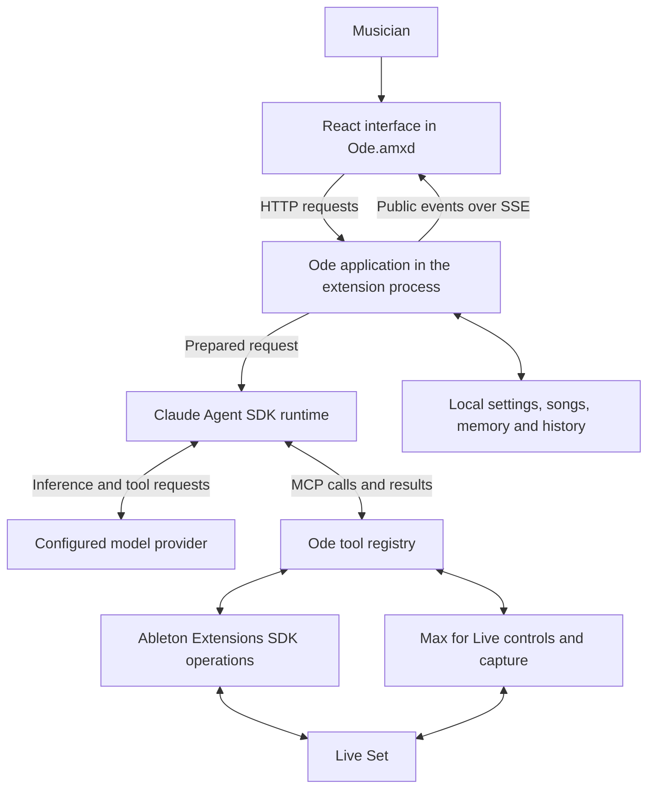

# Architecture

Ode connects a model conversation to an editable music project. The model chooses what musical change to make; Ode supplies the current project, exposes specific operations, and executes permitted calls through Live. After a change, it can read the resulting state and, with the Meta transport, return captured audio to the same conversation.

The application is written in TypeScript. Its React interface runs in a Max for Live window, while a local HTTP server and most application logic run in the Ableton extension process. The agent loop runs through the official Claude Agent SDK and its packaged child executable. The SDK manages the conversation and tools; the model selected in Ode's Settings supplies the inference. With Meta selected, that model is a Meta Muse model, with Muse Spark 1.3 as the bundled default.

## Two ways into Ableton

Ableton supplies two programming environments used by Ode. The **Extensions SDK** is a JavaScript and TypeScript API for interacting with the Set, including tracks, clips, notes, and devices. It currently requires Live 12 Suite Beta. Ode's extension registers right-click commands, starts the application, and uses SDK operations for most object inspection and editing. [Ableton Extensions SDK](https://ableton.github.io/extensions-sdk/).

**Max for Live** lets developers build devices inside Live. A Max device can work with audio and expose controls or an interface. Ode's `Ode.amxd` hosts a web view for the React application and supplies processed audio capture and additional native controls. The division of work follows what each API exposes; [Live integration](live-integration.md) explains it in detail. [About Max for Live](https://www.ableton.com/en/live/max-for-live/).

SSE means Server-Sent Events, the HTTP event stream the interface uses for activity and state updates. MCP means Model Context Protocol; here it is the tool interface supplied to the agent runtime. Neither requires a remote Ode service. The model provider is remote, while the application server listens on this computer.

[OdeExtension](../src/live/extension/extension.ts) is the entry point loaded by Live. It constructs [OdeApp](../src/server/app.ts), which connects the server, models, tools, song stores, sessions, and native bridges. This composition is useful when following ownership in the source: a component's dependencies are supplied there rather than discovered from a global application object.

The extension is Ode's Node.js application host, and its SDK path supplies typed project objects, context-menu targets, and transactions for native edits. Max fills specific gaps in the pinned SDK: a persistent companion window, processed signal capture, and additional Live controls. This is the division implemented by Ode, rather than a claim that a different application could not place more logic in Max. The requirement-by-requirement explanation is in [Live integration](live-integration.md); the [workflow guide](workflow.md) follows startup through completion.

## A request begins with the current project

Consider “Make this bass less busy under the vocal.” If the musician invokes Ask Ode from a clip, the context menu builds a reference to that object and stores it as the explicit target. The UI submits the message to the local server, and the song's session accepts it with a request identifier. Acceptance is persisted before execution continues, so a delivery retry can refer to the same accepted request.

Before an ordinary request reaches the agent, [RequestContext](../src/server/request-context.ts) reads the Set. A **snapshot** is a structured observation of the supported tracks, devices, clips, mixer values, and song data at that point. The snapshot reader requires that observation to succeed; a failed read does not become an empty project. Ode compares it with the previous recorded state and records intervening hand edits before preparing the model's context.

The model receives a compact project map, the request, the last explicit right-click target, the interaction mode, and a selected summary of artist and song memory. A saved production task can contribute progress and blockers. These summaries orient the agent without copying every note and parameter into every message. Exact material remains available through tools when the request needs it.

This distinction matters in the bass example. A map can identify the bass clip and the surrounding tracks, but the agent still needs to read the actual notes before deciding which ones to remove. It must also consider the vocal and shared dependencies relevant to the change. A track name alone cannot establish what the part sounds like.

## The runtime chooses and calls tools

[AgentLoop](../src/harness/loop.ts) supplies the prompt, conversation, model settings, tools, and lifecycle hooks to the Claude Agent SDK. The SDK manages iteration, conversation persistence, context compaction, and agent delegation. Ode provides the music-facing tools through an SDK MCP server.

The registry organises tools into `daw_write`, `daw_read`, `mneme`, `lyrics`, and `operations`. These are functional categories: native editing, project inspection and listening, persistent context, lyric work, and supporting interaction. A separate `changes` field declares each tool's treatment as an observation, Set change, or persistent-memory change. Permissions and scheduling use that field, not the group's name. For example, `processed_audio_capture` belongs to `daw_read` but declares a Set change because it can temporarily alter routing and transport. [ToolRegistry](../src/tools/index.ts) resolves and validates calls before running the implementation. The full group map and call path are in [Tools and permissions](tools.md).

The agent also has a catalogue of **skills**. A skill is a Markdown document describing a useful workflow, such as arranging a transition or reviewing a rhyme. The top-level catalogue is appended to the prompt; the agent can read a relevant skill and its references with `skill_read`. Skills guide decisions but cannot add an operation that Live does not expose. Their evaluation fixtures are excluded from the packaged skill texts.

The runtime can delegate an independent inspection to a producer subagent. That agent inherits the selected main model and receives registry tools declared `changes: "none"` unless they are marked `mainAgentOnly`. It lacks the declared Set and memory writer tools, cannot ask the musician, and cannot start another subagent. This classification does not guarantee zero local state changes: `lyricist` with `analyse: true` can save annotations, and `lyrics_read` can refresh stored melody observations. The main agent remains responsible for the explicit native edits and lyric-text writes. Lyric work uses a separate configured service, explained in [Lyrics](lyrics.md).

Tool discovery is transport dependent. Although the registry and SDK support discoverable schemas, the current provider environment disables deferred tool search because gateway support has not been established. The implementation therefore does not depend on every tool schema loading only when needed. [AgentEnvironment](../src/harness/agent-environment.ts) records that choice.

## Calls pass through application controls

Before an Ode tool runs, the runtime hook identifies its caller and checks whether that caller can use it. The application then applies the current mode and approval rules. Manual mode waits for Apply or Skip on musical and settings changes. Background artist-memory maintenance and production checkpoint updates are handled separately. Deletions outside supported recovery and tools marked as requiring consent ask in either mode.

Locks and current-state checks add another layer. The registry checks protected material before relevant writes, and an explicit attempt to remove a lock requires approval. Existing MIDI replacement uses a token from the note read so stale material can be refused. The exact permitted tool name and validated arguments are bound to the runtime's tool-call identifier before invocation. These checks are implemented in [AgentTools](../src/harness/agent-tools.ts), [OdeSession](../src/harness/session.ts), and the registry.

Within a request, the harness can admit up to six concurrent calls declared `changes: "none"`. Calls declared as changes wait for earlier tracked reads and writes; later reads wait for that write. Native execution has additional queues: operations dispatched through the SDK [OperationRegistry](../src/live/extension/ops/registry.ts) run serially, and the Max audio, parameter, and DAW-control channels have their own policies. Six admitted calls therefore do not mean six simultaneous native edits or renders. The application does not assume that different tracks are independent, because they can share routing, return effects, or global state.

## Listening and provider transport

For Meta, [MetaTransport](../src/harness/meta-transport.ts) translates the agent runtime's Messages requests into requests to Meta's Responses endpoint. This is HTTP and message-format translation; the Claude Agent SDK still owns the agent loop. The transport also converts captured audio references into actual audio content for the selected model.

When a tool captures a bass passage, the audio becomes input in the main conversation. The model can assess it with the original brief and earlier observations still available, then choose another edit. There is no separate listening agent or local musical assessment engine between the recording and that decision. The current Baseten and Modal agent paths use their Messages gateways and do not support audio input in this integration.

Speech dictation follows a different path. The interface's [microphone recorder](../src/ui/app/microphone.ts) uses the browser's audio facilities to prepare mono PCM16 WAV for transcription, which is a service request outside the main agent loop. [Dictation](../src/server/dictation.ts) validates the recording, calls the configured transcription role, and removes its temporary file afterward. The recognised text is appended to the musician's editable draft; it is not automatically submitted as a musical request. Recording audio as a reference instead retains an attachment for the main conversation. The role mapping is defined in [ModelRoles](../src/services/model-roles.ts).

## Completion, interruption, and history

After the agent finishes, Ode reads the state again and records changes it can observe. For covered writers, **mutation receipts** describe the actual scope and before/after material of an edit. The recorder compares those receipts with the resulting snapshot before attributing a version to Ode. When it cannot establish complete ownership, it can record the change as observed rather than claim that every difference came from the agent.

The UI receives the reply, activity, and any version entry through the event stream. A successful native write establishes that an operation ran. It does not establish that the music improved, that the model heard the final mix, or that every part of the Set can be restored. Those conclusions require the corresponding observation and supported recovery path.

Stop cancels further agent work and drains the tool promises tracked by the harness. A settled promise does not establish that every already-issued native action completed or was rolled back; a control-channel cancellation can leave the actual host outcome needing inspection. A later message can also interrupt the active request and continue with updated direction. Completed changes are not automatically reversed. If interruption prevents a reliable final observation, Ode keeps a pending record and attempts to reconcile it before attributing later changes to the musician. [Memory and history](memory-and-history.md) describes the stored evidence and recovery limits.

## Local communication and stored credentials

[OdeServer](../src/server/http.ts) binds to `127.0.0.1` on a system-assigned port. The UI authenticates with a per-session token, exchanged for an HTTP-only, SameSite cookie. Request-origin and content-type checks apply to its API. The Max bridge uses a separate pairing capability and private session, scoped to the current Set and device; that credential does not grant access to the general UI API.

Provider keys are stored in local settings with owner-only file permissions requested by the application. The runtime child receives an environment constructed for the selected provider, rather than all inherited service credentials. Changing the model, endpoint, or credential changes the session identity used to decide whether an SDK conversation can resume. This keeps local application state separate from the remote provider connection, while still sending the material required for inference to that provider.
