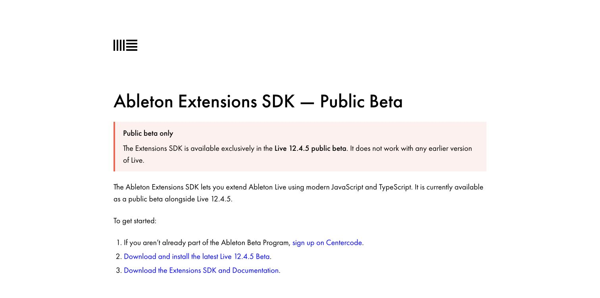
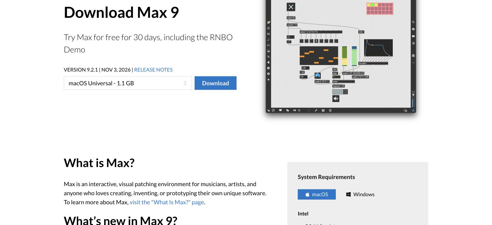
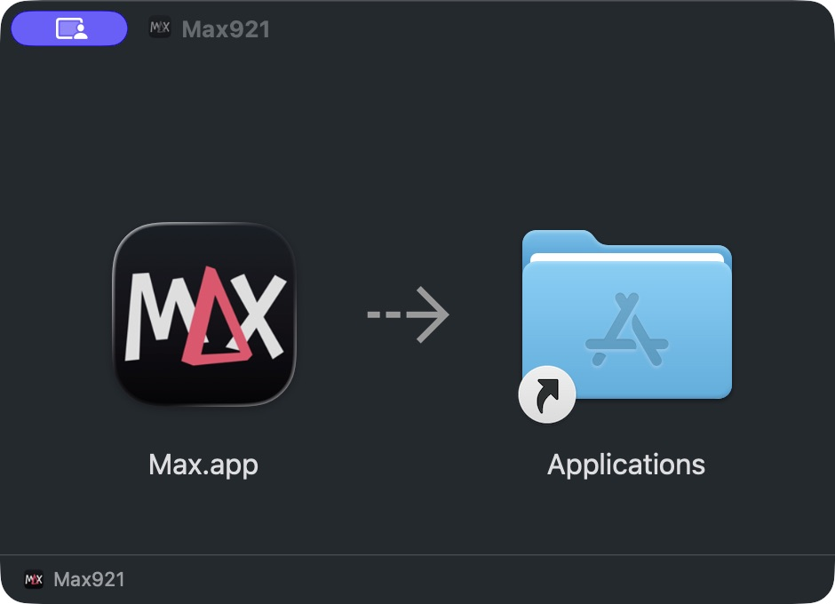
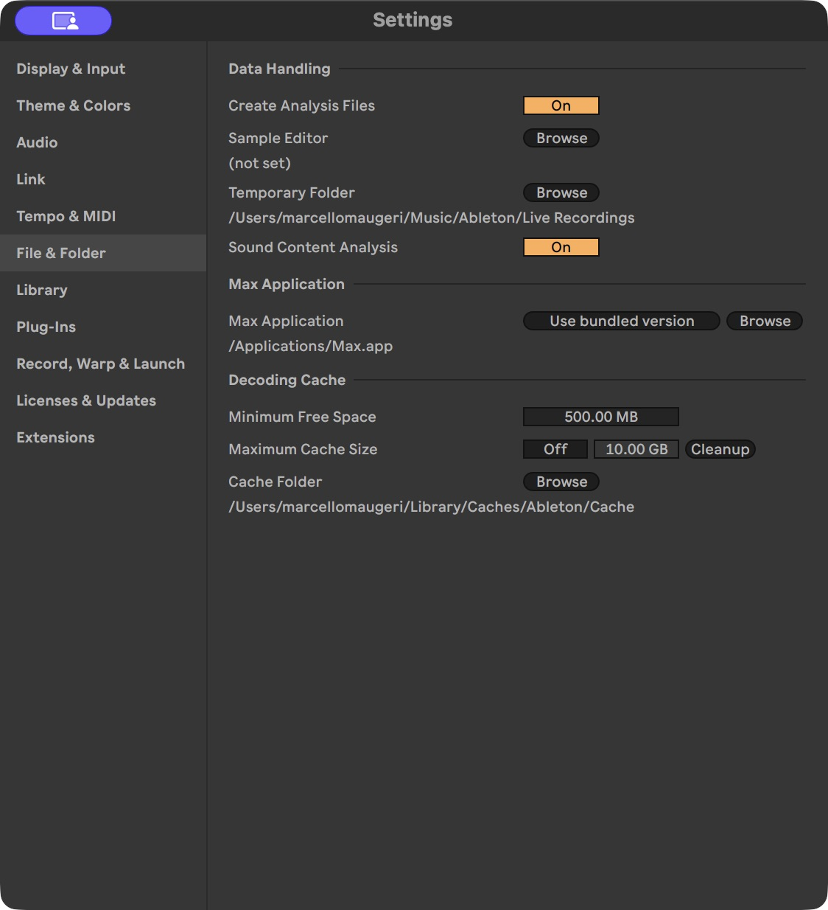
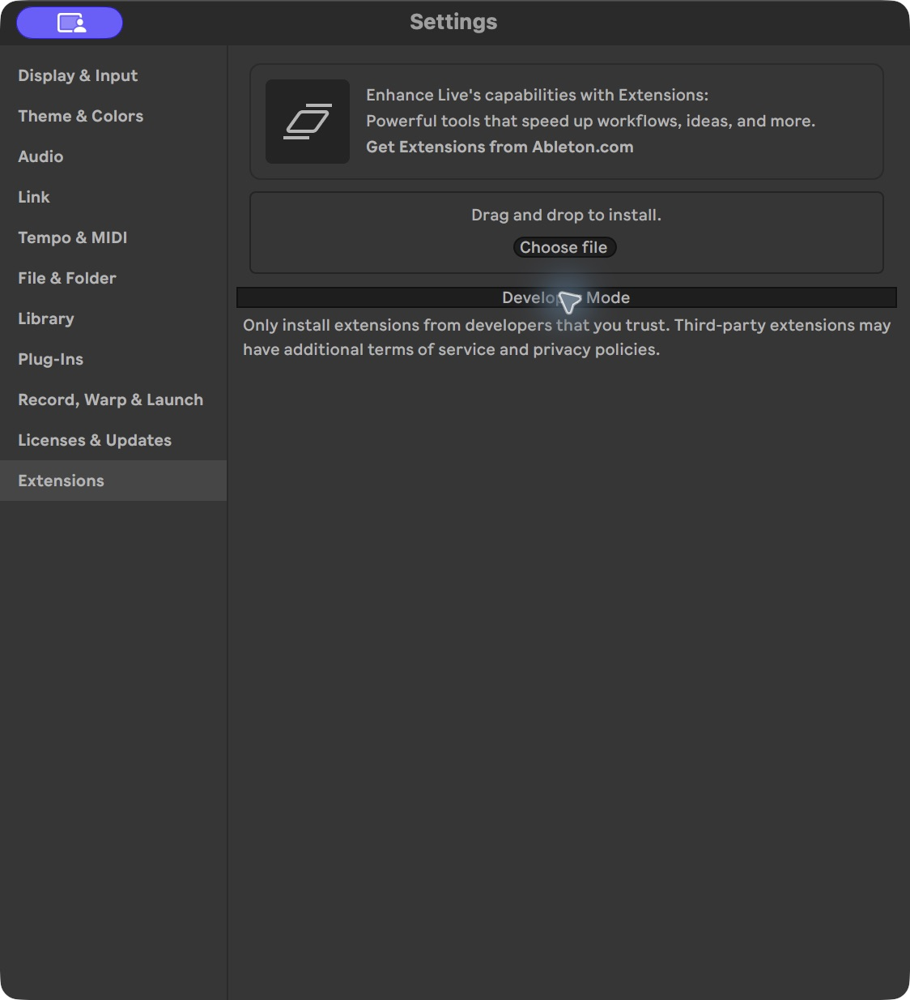
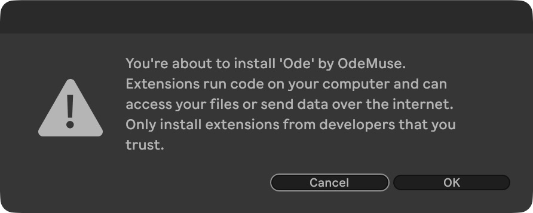
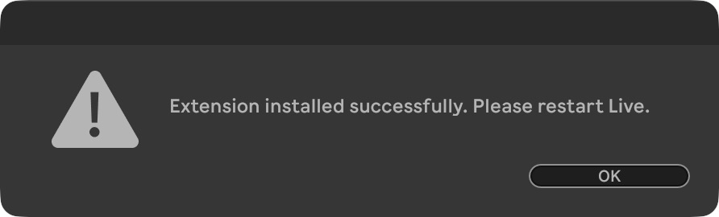
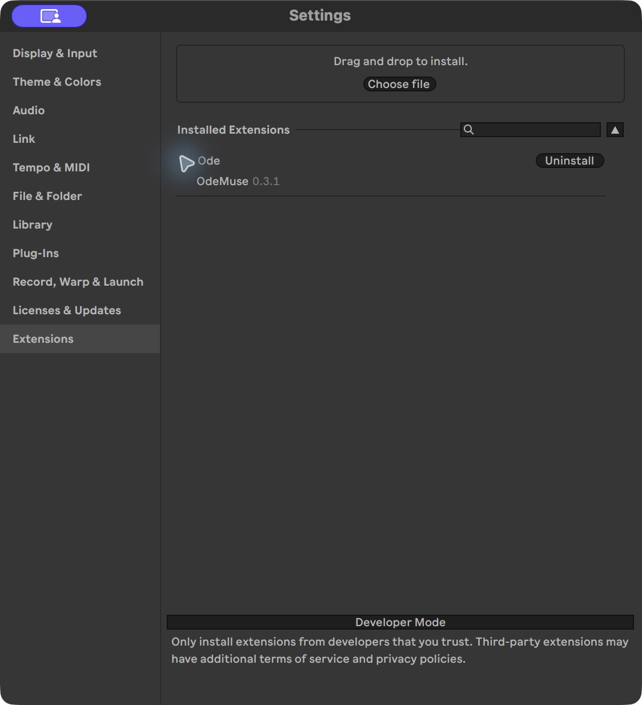
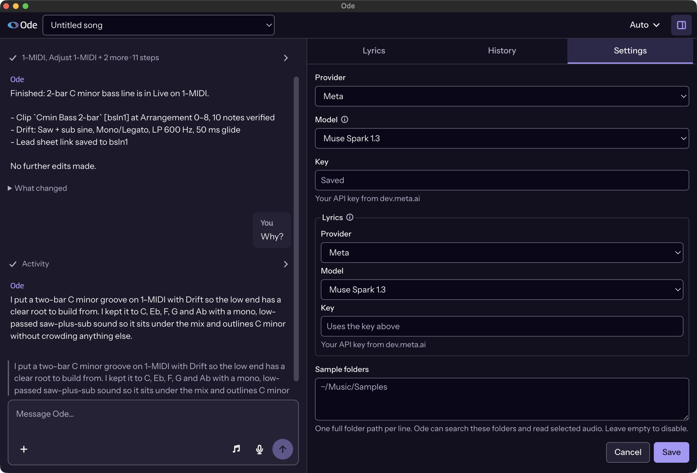

# Getting started

Ode runs alongside the music in an Ableton Live project. You install its extension once, then load its Max for Live device in the project you want to work on. The device opens Ode's interface and connects it to that instance of Live.

If you are new to Live, a **Set** is its project document. A **track** holds a musical part, such as a bass instrument or a recorded vocal. A **clip** holds a passage of MIDI notes or an audio recording. MIDI stores performance instructions, such as note pitch, timing, and duration, which an instrument turns into sound. A **device** is an instrument, effect, or other tool placed on a track. Ode's own device is one of these tools; it provides the window and native connection while the extension runs the application.

## Before installing

Use a current **Live 12 Suite Beta** with Extensions enabled. Extensions require version 12.4.5 or later; the [official SDK page](https://ableton.github.io/extensions-sdk/) explains beta access. Ode's code targets Extensions SDK `1.0.0-beta.1`; future SDK versions may expose different capabilities. The page below puts the Live Beta and SDK download links together. Choose Live Beta to install and use Ode; the SDK download is for developers building extensions.

You also need **Max for Live running Max 9.2 or later on macOS**, or Max 9.1 or later on Windows. Max for Live is included with Suite, and lets Live load custom `.amxd` devices. Ode's device uses it for the floating interface and native audio and control functions.

Model requests need Internet access and your own provider credentials. Ode stores those credentials in its local settings. It sends the conversation and any material needed for a model request to the selected provider, so local storage does not mean inference happens on your computer.

## Select the Max runtime on macOS

Live includes a version of Max, but that bundled version can lag behind Cycling '74's current release. This matters for Ode because Max 9.2.0 fixes Command-key handling in web views inside Max for Live devices. With an older runtime, ordinary typing can work while Copy, Paste, Cut and Select All fail. This is a host issue affecting standard text fields. [Max 9.2.0 release notes](https://cycling74.com/releases/max/9.2.0).

If Live's bundled Max is older than 9.2, download the current macOS version from [Cycling '74](https://cycling74.com/downloads) and install `Max.app` in Applications. In **Live Settings → File & Folder**, find **Max Application**, click **Browse**, and select the installed `Max.app`. Save your work and restart Live so the setting takes effect. Ableton documents this application-path setting in [Setting Up Max for Live](https://www.ableton.com/en/live-manual/12/max-for-live/#setting-up-max-for-live).

Open the downloaded disk image and install Max in Applications.

The Max Application setting should point to the installed application:

This selects the runtime that hosts Ode's window and device. There is no Ode setup step in the Max Console or patch editor. After opening Ode, check that text entry and the usual editing shortcuts work before configuring credentials or starting a session.

## Install the two release files

Open the [Ode releases page](https://github.com/odemusehq/Ode/releases). Download `Ode.amxd` and the extension package for your operating system and processor. Release packages use these suffixes:

| Your computer | Extension suffix |
| --- | --- |
| Apple silicon Mac | `darwin-arm64.ablx` |
| Intel Mac | `darwin-x64.ablx` |
| Windows PC | `win32-x64.ablx` |

In Live, open **Settings → Extensions** and drop the downloaded `.ablx` onto the page, or select it with **Choose file**. Installing a packaged release does not require Developer Mode, so leave it off. If an older Ode extension is installed, uninstall that entry first; Live currently refuses to install over its existing extension folder.

Live identifies **Ode** by **OdeMuse** before installing it. Check those names, then confirm.

When installation finishes, save any open work and restart Live as requested.

After restarting, Ode should appear in Installed Extensions. This capture shows version 0.3.1, with Developer Mode still off.

Drag `Ode.amxd` onto an audio track or the Main track in your Set. Main receives the combined mix. Once Ode is open and configured, [make your first song](tutorial.md) walks through a creative session.

Keep **one Ode device per Set**. The extension finds the device through its native controls and pairs with it automatically. Two copies make that pairing ambiguous. If the device is missing or cannot respond, opening Ode from a right-click menu produces an instruction explaining what needs attention.

Click **Open Ode** on the device. Ode appears in a floating window hosted by Max for Live, so you can keep it beside Live while working. You can also use **Open Ode** on a track or scene's right-click menu. The extension supplies separate **Lyrics**, **History**, and **Settings** actions for those views.

## Configure the models

Open **Settings** in Ode and select the main provider and model. The bundled catalogue supports Meta, Baseten, and Modal. Meta and Baseten offer the model choices listed in the catalogue; Modal can request a model list using your key. The exact identifiers live in [providers.json](../src/services/providers.json), which is the source of Ode's choices.

Choose **Meta** to use the complete listening path described in these guides. In that configuration, a recording captured from Live becomes audio input in the main agent conversation. The current Baseten and Modal agent transports support text interaction and tools, but do not attach audio to the agent. A model's own advertised capabilities do not establish support in a particular transport.

Lyrics support has its own provider and model setting. It currently offers Meta models and can reuse the saved Meta key. If you choose a different provider for the main agent, supply a Meta key for lyrics and speech transcription as needed. The [model-role resolver](../src/services/model-roles.ts) determines which credential each role uses.

An installed release reads its persistent Settings, not the repository's `.env` file. That file is for source development; [Development](development.md) explains the optional credential import for developers.

## Make a first change

Start with an existing part you can recognise, such as a short bass or drum clip. Right-click it and choose **Ask Ode**. This gives Ode an explicit target along with your message. A request such as “Simplify this bass while the singer is singing, keeping the lead-in to the chorus” gives it both an intended change and material to preserve.

Ode reads the project and the details it needs, then performs supported edits through Live's native APIs. Its activity shows public action descriptions and tool progress. After it finishes, inspect the notes or device settings in Live and play the passage. With Meta selected, Ode can capture processed audio and listen during its work as well.

The target from a right-click is context, rather than a permanent selection lock. If you move on to a different part, point Ode at that part or describe it explicitly. The agent is instructed to read current material before changing it because the musician can edit the same Set between requests.

## References and microphone input

You can attach files or a selected folder as references for the conversation. Ode retains those selections so the agent can reopen relevant material later. An attachment can describe a musical direction or provide something to listen to; its filename alone does not establish that the model inspected its contents.

Where the embedded browser supports microphone recording and permission is granted, the input offers two recording actions. Dictation sends speech to the configured Meta transcription service and appends the recognised words to your message draft. You can edit them before pressing Send. Audio recording instead attaches a recording as a reference, so the main agent can receive the sound when you send the request. Sending an audio reference to the agent needs the Meta listening configuration described above; a transcription key by itself does not add audio support to a different main transport.

## Control and continuation

**Auto** mode lets Ode perform clear requested changes. **Manual** mode waits for Apply or Skip before musical and settings changes. Some actions, such as deletions outside supported recovery, require approval in either mode. Background artist-memory updates and production checkpoint updates have separate rules, described in [Architecture](architecture.md).

Use **Stop** to interrupt a running agent request. Operations already issued to Live may still settle, and completed edits can remain in the Set. Ode records the state it can observe after interruption so later work can reconcile with it. Stop is therefore useful for changing direction, but does not promise to roll back every action.

The Lyrics view holds the song's text and annotations. History shows the state changes Ode has recorded, including recovery limits. Ode's song selector changes its stored song context; it does not open a different `.als` project in Live. Keep the selected Ode song matched to the Set you are actually editing, and save the Set in Live as you normally would.

For the implementation behind this session, continue with [Architecture](architecture.md). For a supported action that still needs a manual Live step, see [Live integration](live-integration.md).
