# From a blank Live Set to a first Ode request

This walkthrough starts with installation, introduces a blank Ableton Live project, and follows a small bass-line request into Live's MIDI editor. It then shows the Settings, History, and Lyrics panels. The completed setup was checked on an Apple silicon Mac with Ode 0.3.1, Live 12 Suite Beta 12.4.25b1, and Max 9.2.1, with Extensions Developer Mode off. The screenshots were collected across installation and validation; the conversation image shows the completed request reopened in the embedded window.

For the concepts behind the two Ode files, start with [How Ode fits into Live](../README.md#how-ode-fits-into-live). The [workflow guide](workflow.md) follows the same request through the application and native APIs.

## 1. Get the compatible Live Beta

Open [Ableton's Extensions SDK page](https://ableton.github.io/extensions-sdk/). This one page links to both the compatible **Live Beta** and the **Extensions SDK and Documentation**. Follow its Live Beta link to download Live through Ableton's beta programme.

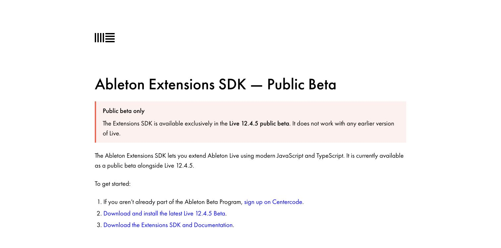

A packaged Ode release needs the compatible Live Suite Beta and the two Ode files described below. The SDK archive is for developers building extensions from source. The page's version wording reflects the beta available when the image was captured; follow Ableton's current requirements when downloading.

## 2. Select a compatible Max runtime on macOS

Max for Live comes with Suite, but Live can bundle an older Max version. On macOS, use **Max 9.2 or later**: version 9.2 fixes the handling of Command-key editing in embedded web views inside Max for Live devices. With an older runtime, Ode can open and accept typing while Copy, Paste, Cut and Select All fail. [Cycling '74's release notes](https://cycling74.com/releases/max/9.2.0).

Download the current macOS version from [Cycling '74](https://cycling74.com/downloads). The captured page offers Max 9.2.1.

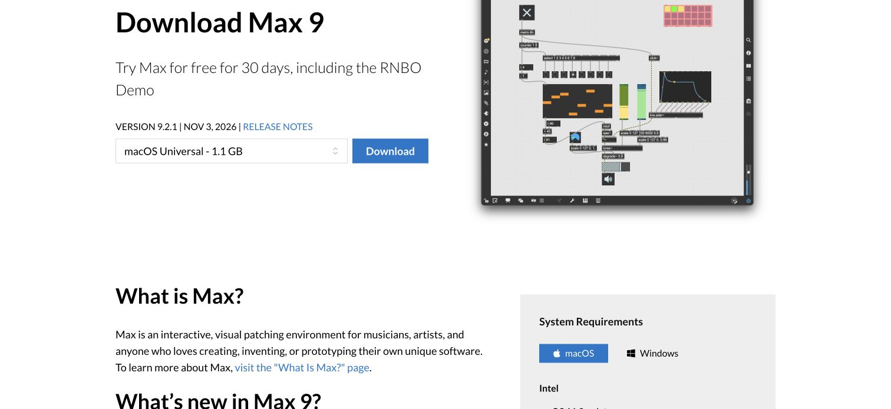

Open the downloaded disk image, review the licence, and install `Max.app` in Applications. The installer shows the application beside the Applications shortcut.

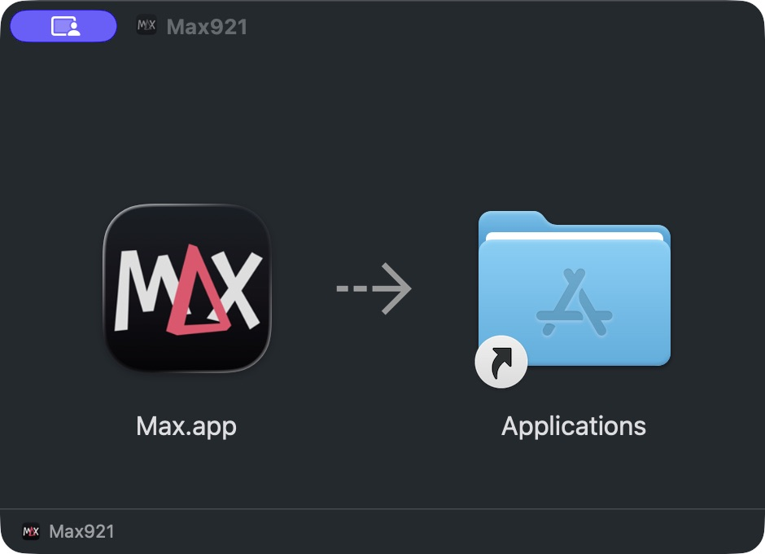

In **Live Settings → File & Folder**, find **Max Application**, click **Browse**, and select `/Applications/Max.app`. Save your work and restart Live when prompted. This is the supported application-path setting documented in [Ableton's Max for Live setup guide](https://www.ableton.com/en/live-manual/12/max-for-live/#setting-up-max-for-live).

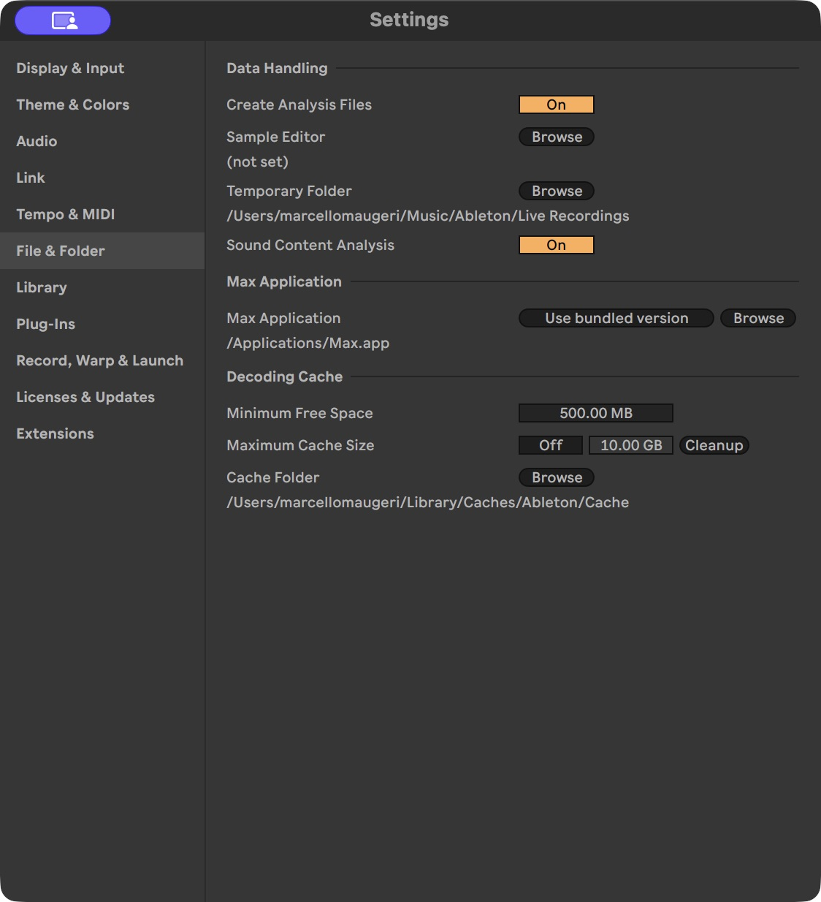

This selects the runtime that hosts Ode's device and window. You do not need to open the Max Console or edit a Max patch. After installation, eject the disk image; the downloaded `.dmg` can be deleted. Windows uses Max 9.1 or later and does not need this macOS Command-key fix.

## 3. Download the two Ode files

Open the [Ode releases page](https://github.com/odemusehq/Ode/releases). Download **Ode.amxd** and the **.ablx** package for your computer: `darwin-arm64` for an Apple silicon Mac, `darwin-x64` for an Intel Mac, or `win32-x64` for Windows.

The `.ablx` installs the application into Live. `Ode.amxd` is the Max for Live device that belongs in each Set where you use Ode. Keep both files from the same release, because the device and extension communicate through a shared protocol.

## 4. Install the extension in Live

Open **Settings → Extensions**. Click **Choose file** and select the `.ablx`, or drag it onto the installation area. **Developer Mode stays off** for this packaged installation. It is used when running Ode from source through an external development host; the requirement to use a Live beta does not make Developer Mode necessary for a release.

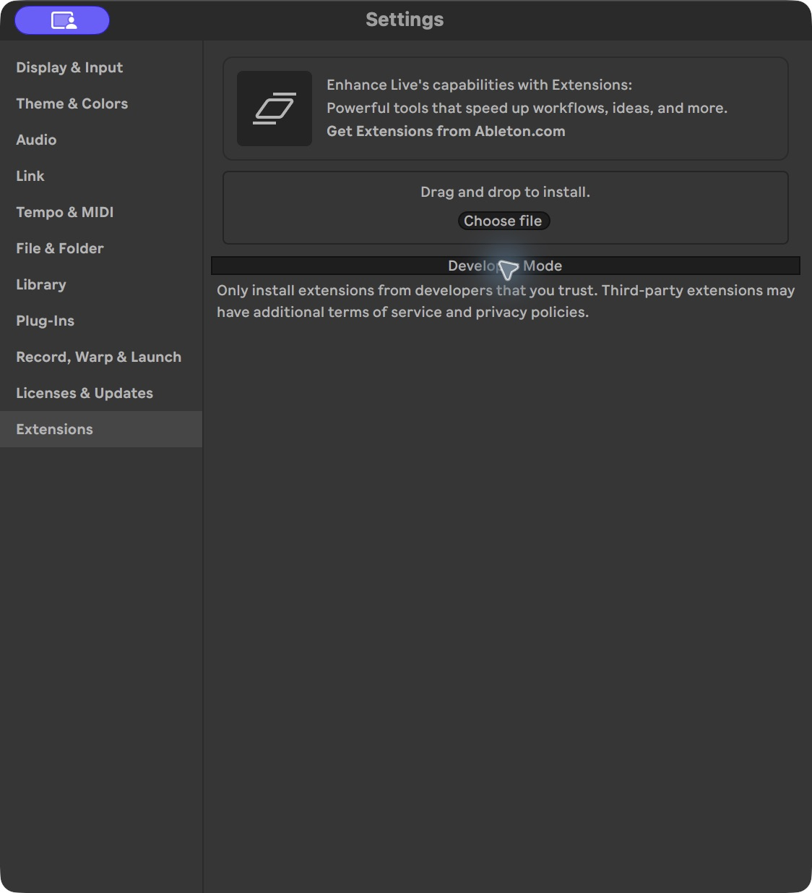

If an older Ode extension is already installed, uninstall its entry before installing the newer package. Live currently refuses installation over an existing extension folder.

Live identifies the extension and publisher before installing it. For Ode, the confirmation names **Ode** by **OdeMuse**. Check those names and confirm the installation.

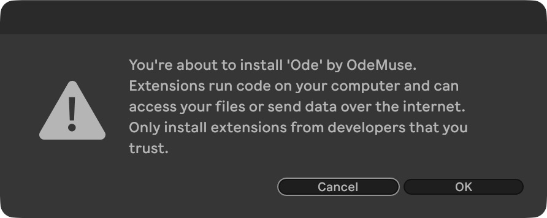

When Live reports that installation succeeded, dismiss the message, save any open work, and restart Live. The installation dialog explicitly requests this restart.

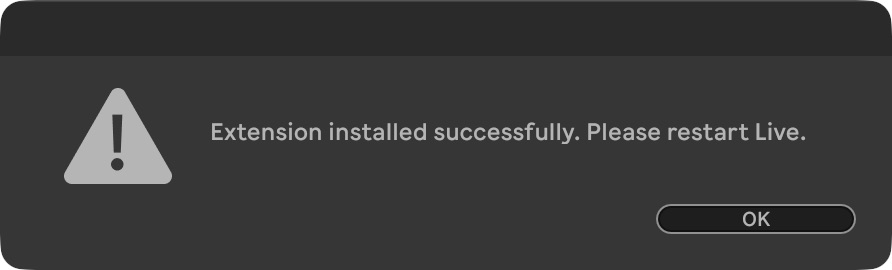

After restarting, return to **Settings → Extensions** and expand Ode's row. The installed entry below shows **OdeMuse 0.3.1**, while Developer Mode remains off.

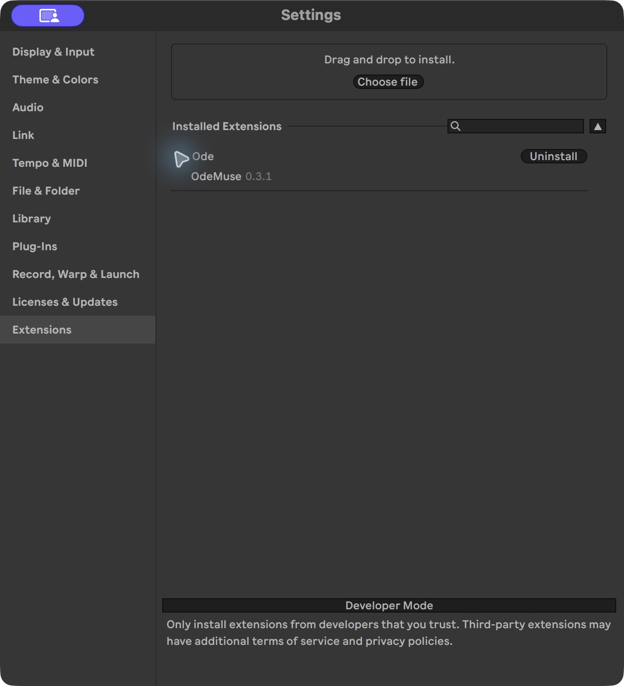

## 5. Create a separate blank Set

Save your existing work before choosing **File → New Live Set**, then save the new project under a separate name, such as **Ode Tutorial**. A Set is Live's project document: it holds the tracks, clips, devices, and arrangement that you and Ode will work on.

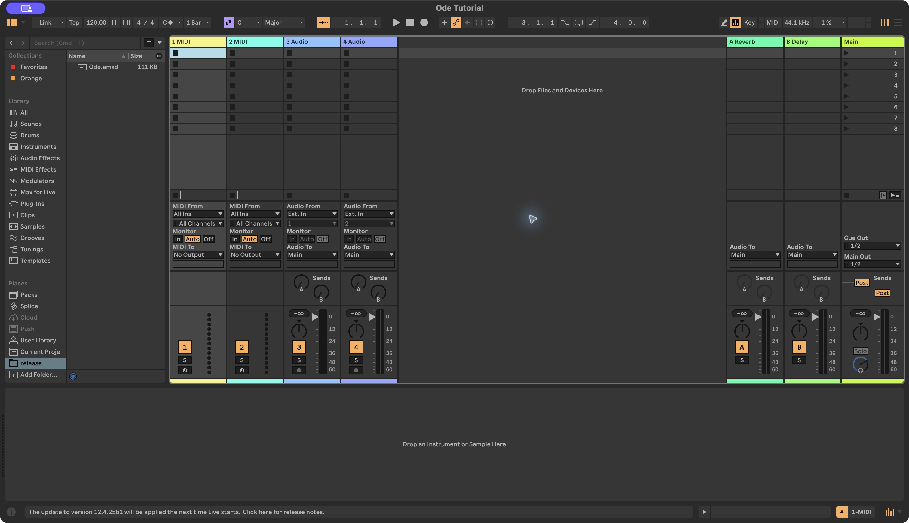

This is **Session View**, where each column is a track and the empty cells are slots for clips. The first two tracks hold MIDI performances. MIDI notes describe what to play; an instrument is needed to turn them into sound. The two audio tracks hold recordings or audio files, while **Main**, at the right, receives the combined mix. Live also has **Arrangement View**, which places the tracks against a shared timeline.

## 6. Load the Max for Live device

Drag **Ode.amxd** from Finder, File Explorer, or Live's Browser onto an audio track or **Main**. Keep **one Ode device per Set**. Selecting its track displays the device in Live's lower panel, where its **Open Ode** button is available. Save the Set after loading it.

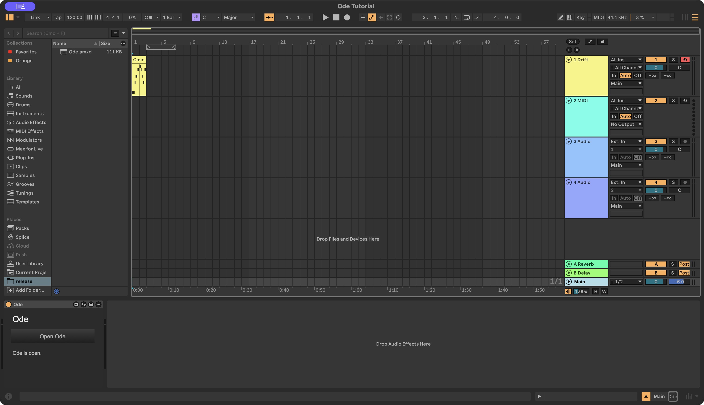

The extension remains installed in Live, while the device belongs to this Set. Together they provide the application, floating interface, additional native controls, and processed-audio capture. Keeping one device lets the extension identify its partner unambiguously.

Click **Open Ode** on the device. You can also right-click an ordinary MIDI or audio track and open the **Extensions** submenu. Ode's actions open the conversation, target a request with **Ask Ode**, or show the **Lyrics**, **History**, and **Settings** panels.

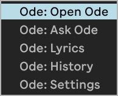

## 7. Configure the models

Open **Settings** in Ode. Choose the main provider and model, enter your API key, and save. The example uses **Meta → Muse Spark 1.3**. Meta also supports Ode's integrated listening path, in which a recording captured from Live becomes audio input in the agent conversation.

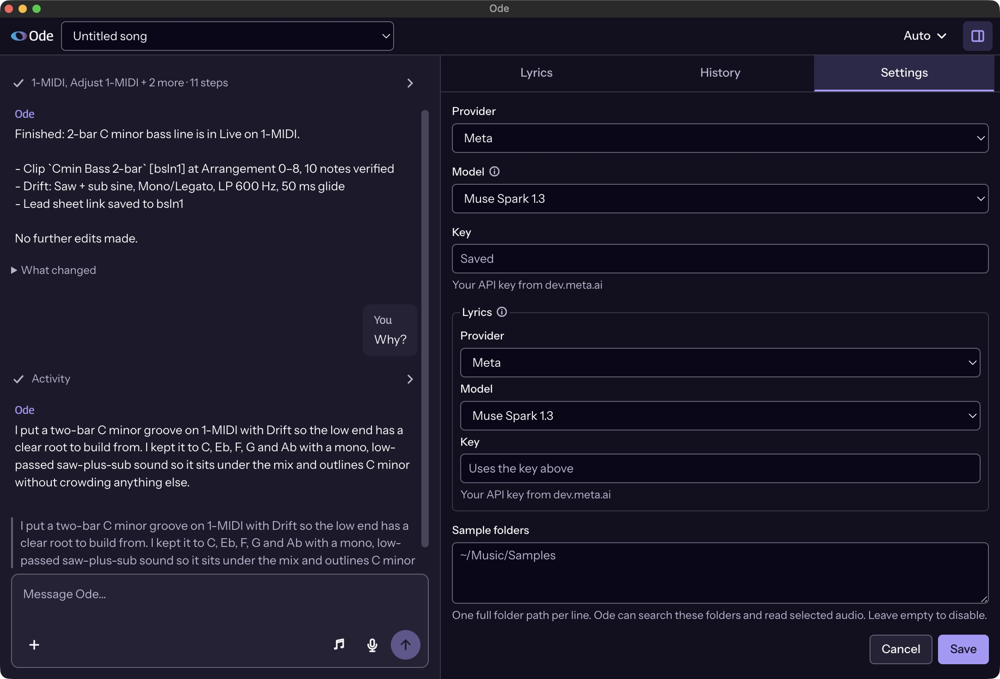

The **Lyrics** settings configure the separate model used for lyric interpretation and writing. They can reuse the main Meta key, as in the example. A field showing **Saved** indicates an existing credential; the screenshot does not contain the key itself. The [getting-started guide](getting-started.md#configure-the-models) explains the provider differences.

The split-panel button in the upper-right corner opens or closes these side panels while keeping the conversation available. After the macOS runtime setup, check that the message box accepts normal typing and editing commands before starting your first request.

## 8. Ask for a small musical change

In the blank Set, send:

> Make a two-bar bass line in C minor on the first MIDI track.

The request gives Ode a concrete destination and a short passage to create. It can read that track, add a native instrument, create a MIDI clip, inspect the resulting notes, and report what it changed. You can expand the activity row to see the actions it performed.

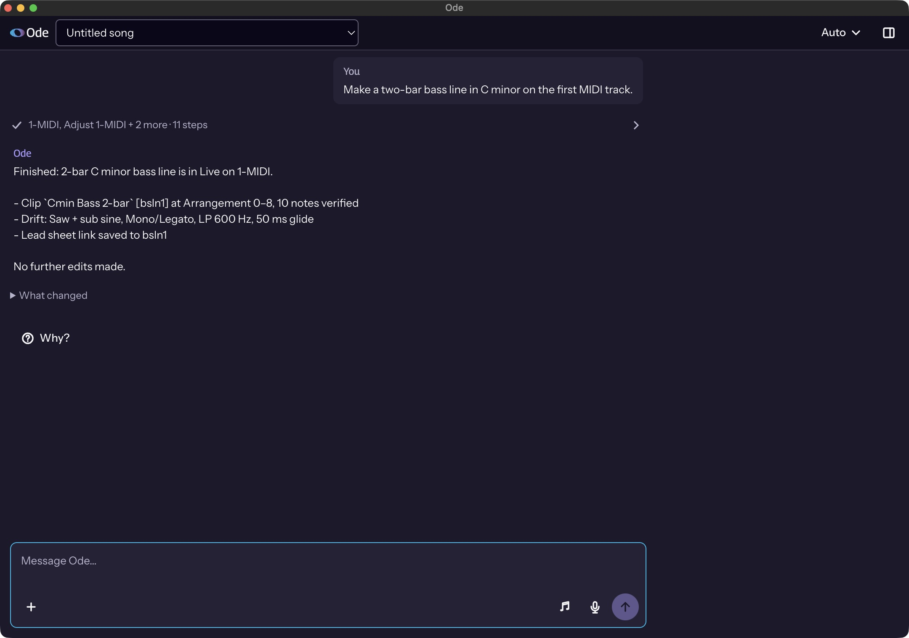

In this run, Ode added **Drift**, a native synthesiser, and created **Cmin Bass 2-bar** with ten notes. Its response identifies Arrangement beats **0–8**. Ode's APIs count beats from zero, while Live labels the first bar as bar 1. In this Set's 4/4 time signature, eight beats span two bars, with the clip ending at the start of bar 3.

The generated pattern can vary between runs. Inspect what appeared in Live rather than treating the response text as verification. The **Why?** action asks Ode to explain its musical choice; the follow-up in this session described the pitches and the low-pass-filtered bass sound.

## 9. Inspect and play the MIDI result

Switch to **Arrangement View** and select the new clip. If the lower panel shows devices, press **Shift+Tab** to switch to Clip View. The piano roll displays pitch vertically and time horizontally; each note's width shows its duration, and the velocity lane below shows its playing strength.

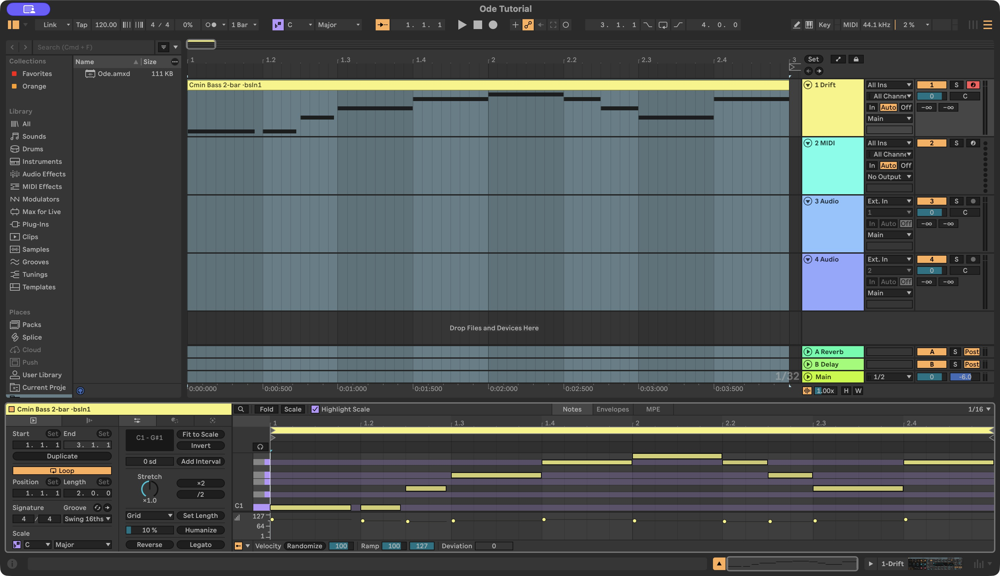

The saved tutorial Set was checked independently: the clip contains ten notes at beats 0–8, using C, E-flat, F, G and A-flat. The visible two-bar loop and note pattern correspond to that result. Select the passage and play it in Live to hear the instrument, then stop playback and save the Set.

## 10. Review History

Open **History** from the side-panel tabs or Live's Ode context menu. It lists the project states Ode has retained, including the initial version and changes observed during its work.

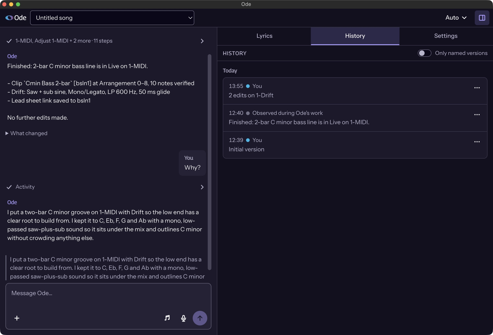

The **Observed during Ode's work** label describes when the state was read. Rows outside a run can also appear when Ode next observes a difference. These labels do not establish who physically performed every change. History can compare and restore supported state, but some native device or plug-in state cannot be reconstructed. Keep saving the `.als` project in Live. [Memory and history](memory-and-history.md) explains the recovery limits.

## 11. Open Lyrics when the song needs words

Open **Lyrics** from the side-panel tabs or context menu. This tutorial song has no lyric sections yet, so the panel offers **+ Section**.

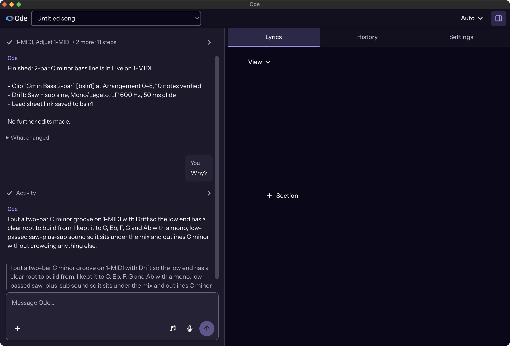

Use that control to begin a verse, chorus, or another section. Lyrics stay with Ode's selected song context and can later be associated with MIDI melody notes. The [Lyrics guide](lyrics.md) explains text editing, syllable and stress interpretation, and those melody associations. Ode's song selector changes its stored song context; opening a different Live Set is a separate action.
