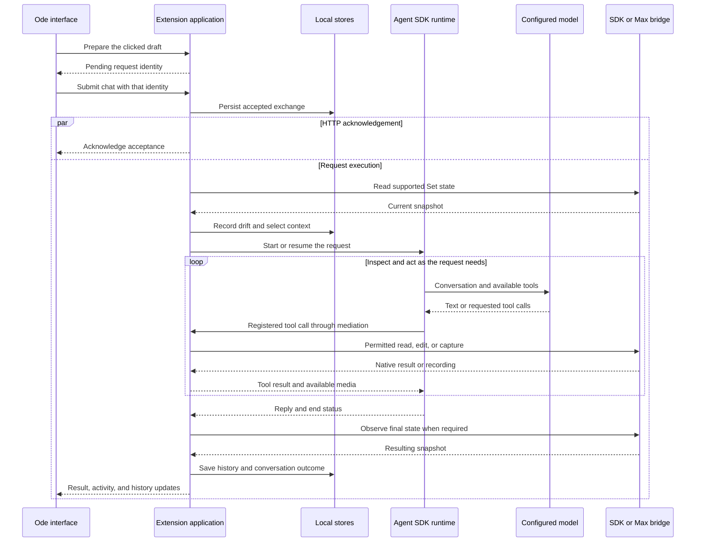

# Workflow

Ode's workflow connects a musician's request to observations and edits in an Ableton Live project. The application has a defined request lifecycle, but the musical work inside that lifecycle is chosen by the agent. A question about a chord can finish with an explanation; changing a bass part can require several rounds of reading notes, editing, and listening.

The main components have different jobs. Live owns the **Set**, its project document, and produces the sound. Ode's extension hosts the local application and uses the Ableton Extensions SDK to work with project objects. `Ode.amxd`, its Max for Live device, supplies the floating interface, native controls, and processed audio capture. The Claude Agent SDK manages the model conversation and tools; the model selected in Ode's Settings makes the musical decisions. [Architecture](architecture.md) maps these components, and [Live integration](live-integration.md) explains why Ode uses both Ableton interfaces.

## The overall request path

This diagram follows an ordinary submitted request that uses native Live tools. Memory reads, lyric-service calls, and questions can also happen inside the agent loop without a native operation for each call. The application's public activity reaches the interface throughout the run, rather than only in the final response.

## Startup and the connection to Live

Live loads [OdeExtension](../src/live/extension/extension.ts), whose activation function initialises the pinned Ableton SDK. The extension receives persistent storage and temporary directories from Live. It builds the native operation registry, connects it through `InProcessLive`, and creates [OdeApp](../src/server/app.ts).

OdeApp constructs the stores, settings and model services, tool registry, agent sessions, request preparation, and recovery services. It opens the last selected Ode song and starts the local HTTP server on `127.0.0.1` with a system-assigned port. An Ode song is the application's stored context; opening it does not load a different `.als` file in Live.

The extension then discovers one matching Max device in the current Set. It passes a short-lived pairing capability through the device's native parameters. The device connects back, establishes a private session, and polls for window and native-control commands. Opening Ode loads a session-authenticated local page in the device's `jweb`, an embedded web browser. The React application uses HTTP requests for actions and Server-Sent Events, or SSE, for public activity and state updates.

This pairing separates the current Set and device from another running session. A missing, duplicated, or unresponsive device prevents the normal window connection and produces an instruction for the musician. [MaxWindow](../src/live/extension/max-window.ts), [MaxWindowBridge](../src/server/max-window.ts), and the [device script](../src/live/max/window.js) implement the two sides.

## From a draft to an accepted request

The text field is a saved message draft, called the **composer** in the implementation. It can hold text and selected attachments before anything is sent to a model. The [ComposerStore](../src/mneme/composer-store.ts) keeps that draft per song, including revision and writer identities so two windows can detect conflicting edits.

When the musician presses Send, the interface captures that version of the draft. `/api/composer/send` validates and freezes a pending send with a request identity; it does not start the agent. The interface then submits the text and identity to `/api/chat`. That route checks the song and prepared payload, retrieves the matching attachments, and asks the current session to accept the request. These routes are defined in [OdeServer](../src/server/http.ts) and named in the [shared API contract](../src/shared/api.ts).

[OdeSession](../src/harness/session.ts) persists acceptance before acknowledging it. Repeating a delivery with the same request identity can therefore find the existing exchange instead of creating another one. Execution proceeds independently once the request is accepted, so context preparation can overlap the HTTP acknowledgement. The acknowledgement confirms persistence rather than acting as an execution-start barrier. The interface consumes the sent draft after acknowledgement, while text typed after the original click remains an unsent draft. Acceptance does not mean the model has finished or Live has changed.

File attachment and speech dictation have their own preparation paths. A selected reference is retained before submission and its identity becomes part of the draft. Dictation sends a temporary speech recording to the transcription service and appends the recognised words to the editable draft. It does not submit the resulting text automatically. Audio recorded as a reference instead becomes sound input when the musician sends the message. [Getting started](../README.md#getting-started) describes those controls.

## Preparing current project context

Before an ordinary request starts, [RequestContext](../src/server/request-context.ts) reconciles any pending uncertain observation from an interrupted run. It then uses [SnapshotReader](../src/server/snapshot-reader.ts) to request the supported Set state through the extension and read the stored song document. A failed Set read stops this preparation rather than supplying an empty project to the model.

The new observation is compared with History so intervening hand edits can be recorded. Ode then assembles the request context from the compact project map, relevant artist and song memory, current mode, recent hand edits, any saved production checkpoint, and the last explicit right-click target. The map describes the project's structure; it is not a substitute for reading every exact note or parameter needed for a particular edit.

The target from Ask Ode is the last explicit object the musician pointed at, not a continuously followed selection. It may be stale. For the request “Make this bass less busy while the singer is singing,” the map can help identify the bass and vocal, but the agent still needs current musical material. Its instructions require relevant native inspection, and the existing-note replacement writer requires a token tied to an actual note read.

## Starting or resuming the model conversation

[AgentLoop](../src/harness/loop.ts) resolves the main provider and model from persistent settings. It creates the agent's workspace and a restricted provider environment, then resumes an SDK conversation only when the saved configuration identity matches. That identity includes provider, endpoint, model, credential, and transport choice. When it cannot resume, recent Ode exchanges can seed the new conversation.

The system prompt contains the main agent instructions and a catalogue of top-level skills. Detailed skill instructions are read with `skill_read` when useful. A skill describes a music workflow; tool schemas and implemented native routes determine the actions the agent can actually take.

The main and producer-subagent roles use the selected main model. Lyrics and transcription are separate roles: the lyric service returns proposals or annotations, while the transcription service turns recorded speech into text. With Meta selected for the main agent, a local [transport adapter](../src/harness/meta-transport.ts) translates the SDK's Messages requests into Meta Responses requests, including supported audio content. Baseten and Modal use their Messages gateways in the current agent path. Using the Claude Agent SDK as the runtime does not make Claude the selected inference model.

## Inspection, edits, and listening

The model can request tools, receive their results, and continue the conversation. A registered Ode tool call passes through the runtime hook, caller-access check, schema validation, and application gate before its implementation runs. Relevant state checks and native guards are applied along the path. Manual mode can pause a changing call for Apply or Skip. Runtime additions such as `skill_read` have their own handling. [Tools and permissions](tools.md) describes this sequence and the distinction between functional groups and mutation policy.

For the bass example, a representative route is to read the clip's current notes, inspect the relevant musical context, and construct a revised note list. `midi_clip_set_notes` replaces the notes in that existing clip using the `recoveryToken` returned by the earlier read. The synchronous native guard refuses a changed target or stale note state. The agent must reconcile a refusal with the current material instead of replaying the old replacement.

When listening is useful, the agent discovers actual routes with `processed_audio_sources` and captures a passage with `processed_audio_capture`. Those calls use the Max device and declare Set changes because route discovery and recording can temporarily alter native controls. The extension validates the returned capture, retains a managed recording, and attaches its audio to the main conversation through the Meta path. The model can assess it against the request, make another edit, and capture again. This is an available loop, not a fixed requirement that every request record audio.

The result of a note write establishes the edited material. A new note read can establish what is now stored in the clip. A capture supplies the sound of its declared source and observed range. The model's judgement of that recording is a separate conclusion; no local music-quality or mastering certification is added by the transport.

## Work that continues across model turns

The SDK manages the conversation as it grows, including context compaction. Ode retains reference and audio identities so material can be reopened after it leaves the immediate context. It also offers temporary MIDI material references for exact note collections, avoiding repeated copies of long note arrays. Those references expire with the request or restart; durable musical decisions belong in the Set or retained song data.

For a longer production task, the agent can save a checkpoint describing the brief, steps, progress, blockers, and evidence. Updating that checkpoint does not execute or schedule its contents. The request-scoped `production_execute` tool records an explicit declaration that the current request authorises the saved work, checked against that request's actual text. A Stop hook can ask the model to review unfinished work after new tool use, within the existing limits. These mechanisms preserve continuity and encourage completion, but do not establish that a planned step succeeded. [ProductionRun](../src/harness/production-run.ts) owns the request-level handling.

The runtime limits are configured in [defaults.json](../src/shared/defaults.json). In the reviewed `0.3.1` implementation, the main values are:

| Setting | Default and scope |
| --- | --- |
| SDK turns | 240 for the main run and for each permitted producer run. |
| Producer delegations | Up to 12 within one request; producers cannot delegate again. |
| Output per model turn | 8,000 tokens requested through the runtime environment. |
| Observed request usage | 8,000,000 tokens, counting observed input, output, and cache usage; checked between stream events rather than enforced as a provider billing cap. |
| Text tool-result window | 60,000 characters, with truncation information when a result exceeds it. |
| Artist and song summary | 2,000 characters, separate from the project map. |
| Compact project map | 24,000 characters. |
| Recent exchange seed | Up to 12 exchanges when constructing the recent-history input; a resumed SDK transcript has its own persistence and compaction. |

These limits describe the current application configuration, not a guarantee that every provider accepts a request of that size.

## Completion, Stop, and a change of direction

When the SDK run ends, Ode closes its stream and drains the tracked tool promises. An ordinary request then records the resulting state as needed, using mutation receipts where available to distinguish Ode's covered changes from other observed differences. It saves the conversation's reply and end status, associates a version when one was recorded, and updates the interface. Failure to observe or persist the result is reported as such rather than treated as proof of a complete edit.

Stop prevents further agent work and cancels pending application calls. It does not promise that an already-issued native action is undone or that settling a tool promise proves the host has finished every action. Some control cancellations leave the actual host outcome needing inspection. Completed edits can remain, and an uncertain interval is reconciled before later changes are attributed to the musician.

A typed answer can resolve a pending question. Otherwise, a new ordinary message received during work can interrupt the active run and continue with updated direction and the earlier request as context. Undo and History restore instead run as exclusive application work; they are separate from stopping an agent. A Why response starts from the saved change being discussed rather than ordinary fresh-snapshot preparation. [Memory and history](memory-and-history.md) explains what the application can recover in each case.
